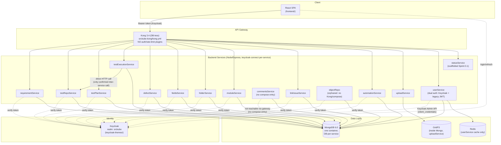
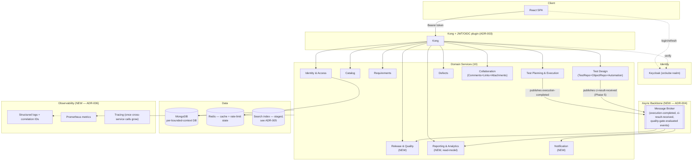

# srckubetest — Enterprise Test Management Platform Transformation Strategy

**Prepared as:** Principal Test Engineer + Senior BA + Enterprise Solution Architect + Product Manager + UI/UX Architect + Quality Engineering Architect
**Repository:** `/Users/arunganesha/srckubetest` (GitLab: `srckube-test/srckubetest`, branch `Aswin-Dev-Final`)
**Method:** Direct repository inspection (file-by-file, service-by-service) — no functionality is asserted without a cited file path. Where the repository provides no evidence, this document says so explicitly rather than inventing capability.

**Delivery status:** Phase 1 of 6 (Foundations & Technical Assessment). See the plan for the remaining phases (Business/Product, UI/UX, Target Architecture, Quality Engineering & Integrations, Roadmap & Registers).

---

## 1. Repository Overview

The repository is a **Docker Compose–orchestrated microservices application**: a React SPA frontend, 14 planned single-purpose Node.js/Express backend services (one, `statusService`, has no code), a Kong API gateway, and a self-hosted Keycloak identity provider — all wired to run together on one shared Docker network (`src-kube-network`), not (yet) on Kubernetes despite the "srckube" naming.

```text
srckubetest/
├── frontend/                 React 18 + TS SPA (CRA/CRACO, MUI v5)
├── backend/
│   ├── automationService/    Test-automation script store (Cucumber/Gherkin editor backend)
│   ├── commentsService/      Polymorphic comments (no compose entry — undeployed)
│   ├── defectService/        Defects
│   ├── fieldsService/        Custom/dynamic field definitions
│   ├── folderService/        Folder hierarchy (scoping container for test assets)
│   ├── linkIssueService/     Bidirectional links between any two tracked items
│   ├── moduleService/        Top-level module/component grouping
│   ├── objectRepo/           UI element locator store (for automation) — orphaned (no gateway/compose wiring)
│   ├── requirementService/   Requirements
│   ├── statusService/        Scaffolded in Sprint 0.1 (2026-08-22) — was EMPTY at initial assessment, see TD-05
│   ├── testPlanExecutionService/ Test plans + test runs, consolidated from testPlanService+testExecutionService (Sprint 1.2, 2026-08-22/23) — makes the one real inter-service HTTP call, to testRepoService
│   ├── testRepoService/      Canonical test case repository
│   ├── uploadService/        GridFS file attachments (different boilerplate lineage)
│   ├── userService/          Users + a second, legacy, parallel auth system
│   └── shared/service-core/  Internal shared library (Sprint 1.1, TD-04) — in use by 3 services so far
├── srckube-kong/              Kong 3.4 gateway config — git submodule-like gitlink, no .gitmodules (repo hygiene issue)
├── keycloak-themes/           Vendored Kalisio Keycloak login/account themes (srckube realm)
└── README.md                  Rewritten in Sprint 0.2 (2026-08-22) — now has real setup/architecture docs
```

**Note (2026-08-23)**: the tree above reflects the repository's state *after* Phase 0/Phase 1 transformation work — `testExecutionService`/`testPlanService` are no longer separate directories (consolidated into `testPlanExecutionService`, Sprint 1.2). The rest of this document, including the tree originally here, described the repository *as found* at the start of the transformation; historical evidence citations elsewhere (e.g. `testExecutionService/controllers/testexecution.js:132`) refer to that original structure and are left as an accurate record of what was found, not edited to match the current layout.

**Evidence → Finding → Impact → Recommendation**

> Evidence: `README.md` is the verbatim GitLab "getting started" template (no project-specific content).
>
> Finding: There is no authoritative onboarding, architecture, or setup documentation anywhere in the repository.
>
> Business impact: New team members and any transformation program have no source of truth; institutional knowledge lives only in code and in the heads of whoever wrote it.
>
> Recommendation: Produce and maintain a real README (local dev setup, service map, env var reference) as part of Phase 0 of the roadmap (Section "Enterprise Roadmap", later phase of this document) — cheap, high-leverage, currently at zero.

---

## 2. Technology Stack

| Layer | Technology | Evidence |
|---|---|---|
| Frontend framework | React 18.3.1 + TypeScript 4.9.4 | `frontend/package.json` |
| Frontend build | Create React App 5 wrapped by CRACO 7 | `frontend/package.json` scripts, `frontend/craco.config.js` |
| UI library | MUI v5 (`@mui/material`) **and** MUI Joy (`@mui/joy`) concurrently | `frontend/package.json` |
| Frontend state | React Context API (~16 separate providers); `@reduxjs/toolkit` is installed but **unused** (zero `createSlice`/`configureStore` references) | `frontend/src/Context/*`, `frontend/src/App.tsx` |
| Frontend routing | react-router-dom v6 | `frontend/src/App.tsx` |
| Frontend auth | `keycloak-js` 25, token pulled live from the Keycloak singleton on every Axios request | `frontend/src/keycloak.js`, `frontend/src/api/axios.tsx` |
| Rich text editing | 4 concurrent libraries: `react-quill`, `slate`+`slate-react`, `@blocknote/*`, `@udecode/plate` | `frontend/package.json` |
| Code editor | Monaco Editor + `monaco-languageclient` + `@cucumber/language-server` (Gherkin/Cucumber script editing) | `frontend/craco.config.js`, `frontend/package.json` |
| Backend runtime | Node.js 22 (alpine), Express 4 | every `backend/*/dockerfile` |
| Backend ORM/DB driver | Mongoose (5.7.1 on 13 services, 6.6.7 on `uploadService`) | `backend/*/package.json` |
| Database | MongoDB 6.0, one shared container, **logical DB-per-service** (14 distinct DB names) | `backend/docker-compose.yml`, each service's `config/config.env` |
| File storage | MongoDB GridFS via `multer-gridfs-storage` | `backend/uploadService/routes/attachment.js`, `utils/upload.js` |
| Cache | Redis (`ioredis`), used only by `userService` to cache Keycloak user lookups | `backend/userService/controllers/users.js`, `backend/docker-compose.yml` |
| Auth/IdP | Keycloak (self-hosted, `srckube` realm), `keycloak-connect` bearer-only middleware on nearly every backend route | every `backend/*/keycloak-config.js` |
| API gateway | Kong 3.4, DB-less/declarative mode, no plugins configured | `srckube-kong/kong.yml`, `srckube-kong/docker-compose.yml` |
| Inter-service comms | Synchronous HTTP (axios) only — no broker | `backend/testExecutionService/controllers/testexecution.js:132` |
| Logging | `morgan` (HTTP) + `colors` (console) — no structured/centralized logging | uniform across `backend/*/server.js` |
| Containerization | Docker + Docker Compose (3 separate compose files: backend, kong, keycloak-themes), no Kubernetes manifests despite `@kubernetes/client-node` being an unused dependency in nearly every service | repo-wide `find`/`grep`, confirmed zero K8s manifests |
| CI/CD | **None** — no `.gitlab-ci.yml` despite a GitLab remote, no GitHub Actions, no Jenkinsfile | repo-wide search |
| Test automation framework (product feature, not repo test suite) | Vendored WebdriverIO "cucumber-boilerplate" bundled inside `automationService` | `backend/automationService/automationFramework/package.json` |

**Evidence → Finding → Impact → Recommendation**

> Evidence: `frontend/package.json` lists `@reduxjs/toolkit`, `reconnecting-websocket`; `frontend/src/Components/comments/comments.tsx` is an empty stub shadowed by `displayComments.tsx`; `frontend/src/Context/AuthProvider.tsx` exists but isn't wired to the live Keycloak-based auth flow.
>
> Finding: The frontend carries multiple dead dependencies and dead/legacy code paths (unused state library, unused websocket library, a stub component, a superseded auth context).
>
> Technical impact: Bundle bloat, contributor confusion about which pattern is "current," and risk that a future contributor wires new code to the dead path by mistake.
>
> Recommendation: A dependency/dead-code audit and removal pass — low-risk, high-clarity cleanup — belongs in Phase 1 of the roadmap (technical foundation), not deferred to a "someday" cleanup.

---

## 3. Current Architecture



**Architectural strengths**
- Clean separation of concerns per business capability (requirements, test repo, test plans, execution, defects, links, comments are each independently deployable services) — a reasonable starting decomposition for eventual scale-out.
- Gateway-fronted API surface (Kong) gives one external entry point and a place to later centralize cross-cutting concerns (auth, rate limiting) that today are duplicated per-service.
- Keycloak as a dedicated, self-hosted IdP is a legitimate enterprise-grade choice (SSO/OIDC-capable), not a toy auth system.
- `testExecutionService`'s snapshot-and-merge pattern (pulling canonical test case/steps from `testRepoService` once, then persisting a per-run copy) is a defensible design: execution history stays stable even if the source test case is edited later.

**Architectural weaknesses (Evidence → Finding → Impact → Recommendation)**

> Evidence: 13 of 15 backend services share byte-identical `middleware/error.js`/`middleware/async.js`, and stale JSDoc route comments (e.g. `backend/folderService/routes/folder.js`, `backend/moduleService/controllers/module.js` still say `@route GET /api/v1/auth/users`); `package.json` `"description": "Devcamper backend API"` is unchanged in most services; unused `utils/geocoder.js`, `utils/sendEmail.js`, `GEOCODER_PROVIDER=mapquest`/`SMTP_HOST=smtp.mailtrap.io` config remain in every clone.
>
> Finding: The backend was scaffolded by cloning a public Express tutorial boilerplate 13 times rather than extracting a shared internal library/template.
>
> Technical impact: Any cross-cutting fix (error handling, security middleware, logging) must be manually replicated 13 times and will drift; contributors inherit tutorial cruft (unused geocoder/email code) that adds confusion with no functional value.
>
> Recommendation: Extract a shared internal `@srckube/service-core` package (or a generator/template) for error handling, auth wiring, logging, and standard middleware; strip vestigial tutorial code during the Phase 1 technical-foundation work.

> Evidence: `srckube-kong/kong.yml` defines a route for `istatusservice` (`/api/v1/issuestatus`) and for `objectRepo` is absent entirely; `backend/objectRepo` is fully implemented (routes/controllers/models exist) but has no Kong route and no `backend/docker-compose.yml` entry; `backend/statusService` has no `package.json`/source at all and is git-untracked; `commentsService` is fully implemented and gateway-routed but has no `backend/docker-compose.yml` entry.
>
> Finding: Three services are in inconsistent deployment states — one fully built but unreachable via the gateway (`objectRepo`), one fully built but not deployable via Compose (`commentsService`), one gateway-reserved but entirely unimplemented (`statusService`).
>
> Business impact: The "edit flag on comments" feature (recent commits `a00f69f`, `4626ddc`) and any object-repository/automation feature relying on `objectRepo` are effectively **not runnable end-to-end today** via the standard deployment path.
>
> Recommendation: Reconcile Kong routes, `docker-compose.yml`, and actual service implementations as a first-sprint task; decide and either finish or delete `statusService`.
>
> **Status (2026-08-22, Sprint 0.1/0.2): all three fixed and live-verified.** `commentsService` and `objectRepo` (new Kong route added) added to `docker-compose.yml`/`kong.yml`; `statusService` scaffolded from scratch (mirroring the `moduleService` boilerplate pattern, using the correct env-driven Keycloak config from day one) and reconnected to its 8 recovered historical documents. All 15 services now respond consistently through the gateway.

> Evidence: `backend/docker-compose.yml` injects `testRepoService: testreposervice:3000` as a plain env var consumed by `axios.get()` in `backend/testExecutionService/controllers/testexecution.js:132`; no service registry, circuit breaker, retry, or timeout wrapper is present around that call.
>
> Finding: The one confirmed inter-service call is a bare synchronous HTTP request with hardcoded host:port and no resilience pattern.
>
> Technical impact: If `testRepoService` is slow or down, every execution-detail fetch in `testExecutionService` blocks/fails with no fallback, no timeout configured, no retry — a single dependency failure cascades directly into a second service's user-facing latency/errors.
>
> Recommendation: Introduce a shared HTTP client wrapper with timeout + retry + circuit breaker (e.g. `axios-retry`/`opossum`) for all inter-service calls as service-to-service calls increase during the transformation.

> Evidence: `express-session` is configured with the default in-memory `MemoryStore` in the Keycloak middleware setup used by (nearly) every service (per-service `keycloak-config.js`/`server.js` pattern), and every service also lists `@kubernetes/client-node` as an unused dependency.
>
> Finding: Session state is process-local, not shared/distributed, while the codebase's own naming ("srckube") and dependency choices signal an intent to run on Kubernetes with multiple replicas.
>
> Technical impact: Running more than one replica of any service today would cause session inconsistency (a request landing on a different pod loses its Keycloak session adapter state) — the code is not horizontally-scalable as written, despite bearer-only Keycloak validation reducing (but not eliminating) reliance on that session store.
>
> Recommendation: Confirm whether `keycloak-connect`'s bearer-only mode (`bearerOnly: true`, present in every `keycloak-config.js`) makes the in-memory session moot in practice (likely, since bearer-only mode does token introspection per-request rather than session-backed login) — if so, this is lower risk than it looks and should be explicitly documented rather than assumed; if any service uses session-backed (non-bearer) flows, that is a blocking issue for horizontal scaling.

---

## 4. Current Product Capability Assessment

| Capability | Exists? | Repository Evidence | Maturity | Gap | Recommendation |
|---|---|---|---|---|---|
| Organizations | No | Not evidenced in repository – requires clarification/discovery. No `Organization` model found anywhere. | — | No tenancy boundary above "project"-like concepts | Design an explicit Organization entity (see Target Domain Model, later phase) |
| Projects | Partial | `frontend/src/Pages/projects.tsx`, `Context/ProjectContext.tsx`, `Pages/createNewProject.tsx` exist in the UI; **no `Project` model/service was found in the backend** — no `backend/*/models/project*` anywhere | Low | UI implies a project concept with no confirmed backend persistence model | Not evidenced in repository – requires clarification/discovery on where/how project data is actually stored (possibly inside `userService` or `moduleService`, not confirmed) |
| Teams | No | Not evidenced in repository | — | No team/membership model found | Net-new |
| Users | Yes | `backend/userService/models/User.js`, dual auth (legacy JWT + Keycloak) | Medium (functional but architecturally inconsistent) | Two parallel auth systems; user CRUD routes unauthenticated (`backend/userService/routes/users.js:17,19`) | Consolidate on Keycloak-only; secure CRUD routes |
| Roles/Permissions | Partial | `User.role` enum `['user','admin']` in legacy model (`backend/userService/models/User.js`); Keycloak itself supports realm roles but **no evidence of role/permission checks in any controller** beyond `keycloak.protect()` (authentication only, not authorization) | Low | No RBAC/ABAC enforcement found at project or resource level anywhere | Design and implement real RBAC (see Security Assessment) |
| Requirements | Yes | `backend/requirementService` full CRUD + wildcard search, hierarchical via `parentId` | Medium | No versioning, approval, or baseline fields on the model | Add lifecycle fields (see Section 8/Business Analysis, later phase) |
| Test Cases | Yes | `backend/testRepoService`, `TestCaseRepo` model, `TestSteps: Mixed` | Medium | Steps stored as untyped `Mixed`, not a real sub-document array (a defined `TestStepSchema` exists but is unused due to `typeof: String` typo) | Fix schema typo; formalize steps as typed array; add versioning/review/approval states |
| Test Suites/Folders | Yes | `backend/folderService`, hierarchical via `parentFolder` | Medium | No evidence of "suite" as distinct from "folder" — folders serve as the organizing structure | Not a functional gap per se, but worth clarifying folder-vs-suite semantics for enterprise users |
| Test Plans | Yes | `backend/testPlanService`, embeds `TestCases: Mixed` | Low-Medium | Test cases embedded as unstructured `Mixed` rather than referenced — no clear versioned linkage | Normalize test-plan-to-test-case relationship |
| Test Cycles | Not distinct | `TestExecution` (below) seems to conflate cycle+execution | Low | No separate "cycle" concept found | Clarify whether a cycle grouping above individual executions is needed |
| Test Executions | Yes | `backend/testExecutionService`, snapshot-and-merge pattern pulling from `testRepoService` | Medium | Execution state embedded as `Mixed`, no queryable per-step history/analytics | Normalize execution/step results into queryable documents |
| Defects | Yes | `backend/defectService`, auto-formatted `Bug-{id}`, `dynamicFields` | Medium | ~~List/create routes unauthenticated (`backend/defectService/routes/defects.js`)~~ — **fixed, Sprint 0.1, see TD-02**; still true as of 2026-08-28: no confirmed lifecycle/workflow states beyond a free-text `Status` field (Sprint 2.4, the task meant to close this, is **not started** — see the kickoff plan) | Secure routes (done) — formalize status workflow (tie to `istatusservice`, scaffolded Sprint 0.1 but still not wired in) |
| Releases | No | Not evidenced in repository | — | No release/version entity anywhere | Net-new (see Business Scenario Analysis, later phase) |
| Environments | No | Not evidenced in repository | — | No environment entity | Net-new |
| Test Data | No | Not evidenced in repository beyond ad-hoc `dynamicFields` | — | No dedicated test-data management | Net-new |
| Attachments | Yes | `backend/uploadService`, GridFS-backed, used by defects/requirements/execution via `attachment: Mixed` | Medium | One unauthenticated download route (`GET /download/file/:fileId`) | Secure route |
| Comments | Yes | `backend/commentsService`, polymorphic via `typeId`, includes `isEdited` flag (matches recent commit history) | Medium | Not deployed via `docker-compose.yml` (see Section 3); a dead route (`wildcardSearch`) references non-existent fields | Fix compose gap; remove dead code |
| Notifications | No | `reconnecting-websocket` dependency present but **unused**; no notification model/service found | — | No real-time or async notification mechanism | Net-new |
| Dashboards | No | `frontend/src/Pages/dashboard.tsx` is a static 4-button nav page, no metrics/charts | Very Low | No chart library in the frontend at all | Net-new (see Reporting & Analytics, later phase) |
| Reports | No | Not evidenced in repository | — | No reporting engine or export | Net-new |
| Audit history | No | No audit-log model/collection found anywhere; models only track `createdBy`/`updatedBy`, not a change history | — | No "who changed what when" trail beyond last-writer fields | Net-new — significant gap for compliance/audit personas |
| Tags | No | Not evidenced in repository | — | No tagging found on any model | Net-new |
| Custom fields | Yes | `backend/fieldsService` defines field schemas consumed via `dynamicFields: Mixed` on requirements/defects/test cases | Medium | `fieldsService` has a duplicate unauthenticated route registration bug (`backend/fieldsService/routes/field.js`) | Fix route bug; this is otherwise a genuinely useful, evidenced capability |
| Import/export | No | Not evidenced in repository | — | No import/export endpoints found in any service | Net-new |
| APIs | Yes | REST, Kong-gatewayed, per-service Express routers | Medium | Inconsistent auth enforcement across services/routes (see Security Assessment) | Standardize |
| Automation integration | Partial | `backend/automationService` stores versioned scripts; vendored WebdriverIO/Cucumber framework bundled; Monaco+Cucumber-language-server in frontend suggests an in-app script editor | Low-Medium (build exists, execution/CI ingestion pipeline not evidenced) | No evidence of actual automated-test **result ingestion** from CI into `testExecutionService` | See Quality Engineering Assessment, later phase |
| Object Repository | Yes (orphaned) | `backend/objectRepo`, versioned locator store | Low (deployment gap) | Not reachable via gateway or Compose | Fix deployment wiring |
| Links between items | Yes | `backend/linkIssueService`, bidirectional, unique compound index | Medium | No evidence of typed relationships (e.g. "blocks"/"tests"/"relates to") — links appear generic | Consider typed link relationships for traceability (see Traceability, later phase) |

---

## 5. Frontend Architecture Assessment

**Structure**: `frontend/src` is organized feature-flat (`Components/`, `Context/`, `Pages/`, `Theme/`, `api/`, `model/`) rather than by domain module. All data-fetching lives in one 240-line file (`frontend/src/api/apiCalls.tsx`) with ~38 plain async functions — no react-query/SWR caching layer, so every screen manages its own loading/error state manually.

**State management**: ~16 separate React Context providers (`frontend/src/Context/*`) nested in `App.tsx`, each holding simple `useState` values for one narrow concern (selected folder, selected module, tab list, workspace, project, template, etc.). `@reduxjs/toolkit` is a declared but entirely unused dependency.

> Evidence: `frontend/src/App.tsx` nests ~9+ context providers around the router; `Context/` contains 16 provider files, each independently managing local state with no cross-cutting store.
>
> Finding: State management is fragmented across many small, uncoordinated providers rather than a single source of truth.
>
> Technical impact: Cross-cutting state changes (e.g. "user switched project, which should reset selected folder/module/tab") must be manually coordinated across multiple providers, increasing bug surface as features grow.
>
> Recommendation: Consolidate into a single state layer — either activate the already-installed Redux Toolkit or adopt a lighter store (Zustand) — as part of frontend modernization (see UI/UX phase, later).

**Auth wiring**: `frontend/src/api/axios.tsx` reads the live Keycloak token per-request (`keycloak.updateToken(30)`), a sound pattern. `frontend/src/index.tsx` additionally calls `keycloak.init({ onLoad: 'login-required' })` before mounting `<App />` at all — this is a real, working, app-shell-level authentication gate: an unauthenticated visitor is redirected to Keycloak's own login page and the SPA never renders. **Correction to an earlier finding in this document**: `frontend/src/Components/requireAuth/requireAuth.tsx` exists and its usage in `frontend/src/App.tsx` was indeed commented out, but on inspection it is not a live regression — `RequireAuth` checks `localStorage.getItem('user')`, a flag only ever set by the legacy custom-JWT `Login.tsx` page (`localStorage.setItem('user', ...)`, `frontend/src/Pages/Login.tsx:77`), which is not part of the live Keycloak flow and is not itself a routed page (no `/login` path is registered in `App.tsx`). Enabling `RequireAuth` as originally written would have redirected every user to a non-existent route, since the live app never sets the key it checks. The dead commented-out route block has been removed from `frontend/src/App.tsx` as part of Sprint 0.1 cleanup; `RequireAuth`, `AuthProvider`, `Login.tsx`, and `signUp.tsx` remain as legacy dead code tied to the superseded custom-auth system and should be removed in the TD-12 dead-code cleanup pass (Section 44) rather than "re-enabled."
>
> Evidence: `frontend/src/index.tsx:12` (`keycloak.init({ onLoad: 'login-required' })`); `frontend/src/Components/requireAuth/requireAuth.tsx:11` checks `localStorage.getItem('user')`; that key is set only in `frontend/src/Pages/Login.tsx:77`; no `/login` route exists in `frontend/src/App.tsx`.
>
> Finding: Authentication *is* enforced today, at the app-shell level via Keycloak — the earlier finding that route guarding was "inert" was incorrect; what's actually true is that a second, dead, incompatible guard mechanism existed alongside the real one.
>
> Impact: None — no action required beyond the dead-code removal already tracked under TD-12/TB-14.
>
> Recommendation: Remove `RequireAuth`/`AuthProvider`/`Login.tsx`/`signUp.tsx` during the frontend dead-code cleanup (TD-12, Sprint 1.3 Task 1.3.3) rather than wiring them in — they belong to a superseded auth system.

**Component/library sprawl**: Two icon systems (MUI Icons + FontAwesome), two design systems (MUI Material + MUI Joy), four rich-text editors (`react-quill`, `slate`, `@blocknote`, `@udecode/plate`) are all installed concurrently — see Section 2 for the underlying dependency evidence and Section "Design System Assessment" (Phase 3) for the UX consequence.

**Forms**: No form/validation library (Formik/React Hook Form/Yup/Zod) is used anywhere — forms are hand-rolled with `useState` and native `required` attributes (e.g. `frontend/src/Components/comments/comments.tsx`). Functional but inconsistent validation UX is likely across the app; confirmed in depth during the UI/UX phase.

**Tables**: MUI X DataGrid is used in some views (`Components/LinkIssue/linkissue.tsx`, `Components/Tabs/TestPlanContent.tsx`) while others use hand-built list components (`Components/Lists/mainList.tsx`) — inconsistent data-table patterns across a data-dense product; detailed in the UI/UX phase.

**Testing**: Only the CRA-default `frontend/src/App.test.tsx` exists. No Cypress/Playwright/e2e configuration anywhere.

> Evidence: repo-wide search for `*.test.*`/`*.spec.*` under `frontend/` returns exactly one file (the CRA scaffold default).
>
> Finding: Frontend test coverage is effectively zero.
>
> Technical impact: No regression safety net for a 16-context, multi-editor, data-dense SPA — every change is manually verified or unverified.
>
> Recommendation: See Testing Strategy (Phase 5) for a concrete test-pyramid proposal.

---

## 6. Backend Architecture Assessment

Covered in depth in Section 3 (shared boilerplate clone, inter-service call resilience, session store). Additional points:

> Evidence: `backend/userService/proto/user.proto` defines a gRPC `UserService.GetUserDetails` contract, but `backend/userService/package.json` has no `grpc`/`@grpc/grpc-js` dependency and no `.js` file implements or calls it.
>
> Finding: A gRPC interface was planned (likely for lower-latency inter-service user lookups) but never implemented — dormant/vestigial artifact.
>
> Technical impact: None currently (dead file), but signals an abandoned architectural direction worth an explicit decision (revive as part of target inter-service communication design, or delete).
>
> Recommendation: Address explicitly in the Target Architecture phase's ADR on inter-service communication rather than leaving it as silent dead code.

> Evidence: No `winston`/`pino`/structured logger anywhere in `backend/*` — only `morgan` (HTTP access log) and `colors` (console coloring) per service, each logging independently to its own container's stdout.
>
> Finding: There is no correlation ID, structured log format, or centralized log aggregation.
>
> Technical impact: Debugging a request that spans `testExecutionService → testRepoService` (the one confirmed cross-service call) requires manually correlating timestamps across two containers' raw stdout — effectively impossible at any real production scale.
>
> Recommendation: See Reliability & Observability Assessment below and the Target Architecture phase.

---

## 7. API Assessment

- **Style**: REST only, no GraphQL. Consistent `/api/v1/<resource>` prefix convention via Kong (`strip_path: false`), e.g. `/api/v1/requirement`, `/api/v1/testrepo`, `/api/v1/testexecution`, `/api/v1/defects`, `/api/v1/comments`, `/api/v1/fields`, `/api/v1/folders`, `/api/v1/modules`, `/api/v1/linkIssue`, `/api/v1/attachment`, `/api/v1/automation`, `/api/v1/issuestatus` (reserved, unimplemented), `/api/v1/users/kcUser` (only this one sub-path of `userService` is gatewayed).
- **Versioning**: Path-based `v1` prefix exists but no evidence of a v2 or any deprecation strategy — not yet tested by real change.
- **Pagination/filtering/sorting**: `middleware/advancedResults.js` (shared across 12+ services, one of the only genuinely reusable shared pieces of the boilerplate) provides generic Mongoose query pagination/filtering/sorting — this is a real, evidenced, reusable capability, not a gap.
- **Bulk APIs**: Not evidenced in any service — all routes operate on single resources or full-list queries; no bulk create/update/delete endpoints found.
- **Idempotency**: Not evidenced — no idempotency-key handling on any POST route.
- **Rate limiting**: Not evidenced anywhere (no Kong plugin, no per-service `express-rate-limit` usage found beyond it being a listed but — per the boilerplate pattern — likely unconfigured dependency; needs confirmation during implementation, flagged here as **not evidenced as active**).
- **API documentation**: No OpenAPI/Swagger spec, no Postman collection, found anywhere in the repository.
- **Webhooks**: Not evidenced.
- **Error responses**: Consistent shape is likely (via the shared `middleware/error.js`) but response schema wasn't independently verified field-by-field in this pass — treat as probable, not fully confirmed.

**Evidence → Finding → Impact → Recommendation**

> Evidence: Authorization enforcement is inconsistent route-by-route within the *same* file in multiple services — `backend/fieldsService/routes/field.js` (duplicate `GET/POST /` registration, one protected one not, `:id` CRUD fully open), `backend/defectService/routes/defects.js` (list/create open, `:id` CRUD protected), `backend/userService/routes/users.js` (all CRUD open, `protect` import commented out).
>
> Finding: There is no consistent, centrally-enforced authorization policy — protection is opt-in per route, decided ad hoc by whoever wrote that route, with at least three confirmed services shipping unauthenticated write/read access to business data.
>
> Business impact: Defects, custom field definitions, and user records can currently be read/written by anyone who can reach the gateway, without a valid token — a real, exploitable data-integrity and confidentiality gap in the current build.
>
> Recommendation: Treat as a P0 security fix (immediate — see Section 9) independent of and prior to any larger architectural work; then move enforcement up to the gateway (Kong JWT/OIDC plugin) as a defense-in-depth layer so a single missed `keycloak.protect()` call can't reopen this class of bug.

---

## 8. Database Assessment

- **Model**: Logical database-per-service on one shared MongoDB 6.0 container (`backend/docker-compose.yml`) — 14 distinct database names, one per service, confirmed via each service's `MONGO_URI`.
- **Schema patterns**: Mongoose schemas throughout use auto-incrementing numeric `id` fields formatted into human-readable business IDs (`TestCaseId: "TC-"+id`, `defectId: "Bug-"+id`, `reqId: "Req-"+id`, `TestPlanId: "PLN-"+id`, `TestExecutionId: "Run-"+id`, `linkId: "link-"+id`, `objectId: "OBJ-"+id`) — a consistent, evidenced, human-friendly ID convention across the whole product.
- **Relationships**: Almost entirely implicit/soft (numeric `moduleId`/`projectId`/`parentId` foreign-key-style fields with no Mongoose `ref`/populate usage confirmed, and several critical relationships — `TestPlan.TestCases`, `TestExecution.TestCases`, `Requirement.attachment`, `Defect.attachment` — are stored as untyped `Mixed` blobs rather than typed references or sub-documents.
- **Versioning/audit**: `Automation` and `ObjectRepo` models auto-increment a `version` field on save (real, evidenced versioning) but **no other model** (Requirement, TestCase, TestPlan, Defect) has any versioning, history, or audit trail. No model has soft-delete (`deletedAt`) — deletes are hard deletes.
- **Schema bug**: `backend/testRepoService/models/testrepo.js` defines a `TestStepSchema` sub-document with `typeof: String` (a typo — Mongoose ignores this; should be `type: String`) but it's moot because the parent's `TestSteps` field is declared as `Mixed` rather than an array of `TestStepSchema` — so step data has no schema enforcement at all today.

**Evidence → Finding → Impact → Recommendation**

> Evidence: `Requirement`, `TestCaseRepo`, `TestPlan`, `TestExecution`, `Defect` models have no version/history fields; `TestSteps`, `TestCases`, `attachment` are all typed `Mixed` (schemaless blobs) rather than structured references.
>
> Finding: Core test-management entities are mutated in place with no change history, and their most important nested data (test steps, plan/execution test-case sets) has zero schema enforcement.
>
> Business impact: An approved/baselined test case cannot be audited later — there is no way to answer "what did this test case look like when it passed in release 3.2?" Compliance-sensitive customers (regulated industries) cannot be served without this.
>
> Technical impact: `Mixed` fields bypass Mongoose validation entirely, so malformed data can be written silently and only surfaces as a runtime error much later (e.g. in the frontend when rendering unexpected shapes).
>
> Recommendation: Introduce immutable test-case versions and explicit lifecycle states (draft/review/approved/deprecated), and replace `Mixed` step/reference fields with typed sub-documents or normalized references — detailed further in the Target Domain Model (Phase 4) and Test Case Governance (Phase 2).

- **Indexes**: Only one compound index was confirmed in this pass (`linkIssue`'s unique `{sourceId:1, destinationId:1}`). No indexes were confirmed on the high-cardinality lookup fields most queries would filter by (`moduleId`, `projectId`, `parentId`, business IDs) — this needs deeper query-pattern analysis before making index recommendations, flagged as a follow-up rather than asserted as a confirmed gap.
- **Data growth/partitioning**: No archival, TTL, or partitioning strategy evidenced anywhere — reasonable for current scale, a real gap at the "Large Enterprise" scale tier (see Scalability Assessment).

---

## 9. Security Assessment

### Authentication
- Primary: Keycloak (OIDC), self-hosted, single realm `srckube`, `keycloak-connect` bearer-only middleware per service — architecturally sound choice.
- **Confirmed critical issue**: `userService` runs a **second, complete, legacy JWT auth system** in parallel (`backend/userService/controllers/auth.js` — register/login/forgotPassword/resetPassword using `bcryptjs` + `jsonwebtoken`, cookie-delivered tokens) alongside Keycloak, with no evidence either has been formally deprecated. This is very likely leftover from a pre-Keycloak version of the product that was never fully removed.
- MFA, SAML, SCIM: Not evidenced — Keycloak itself supports these, but no realm configuration or app-level wiring for them was found in this repository (theme files govern login UI, not policy).

### Authorization
- **No RBAC/ABAC enforcement found in any controller.** `keycloak.protect()` is authentication only (valid-token check); no controller was found checking realm roles, resource-level ownership, or project-scoped permissions before performing an operation. Any authenticated user, in principle, can act on any project's data.
- Confirmed unauthenticated (no auth check at all) endpoints:
  - `backend/userService/routes/users.js` — full `/api/v1/users` CRUD (auth import literally commented out).
  - `backend/fieldsService/routes/field.js` — duplicate route registration bug leaves `GET/POST /` effectively open, plus fully-open `:id` CRUD.
  - `backend/defectService/routes/defects.js` — list/create open.
  - `backend/uploadService/routes/attachment.js` — single-file download route open.

### Application security (OWASP-relevant)
- Standard middleware stack present uniformly: `helmet`, `xss-clean`, `express-mongo-sanitize`, `hpp`, `express-rate-limit`, `cors` — genuinely evidenced, a reasonable baseline against XSS/NoSQL-injection/parameter-pollution. This is a real strength worth preserving, not rebuilding.
- **Secrets committed to source control**: every service's `config/config.env` (and its duplicate `config.env.env`) is tracked in git, containing `MONGO_URI`, `JWT_SECRET`, `SMTP_EMAIL`/`SMTP_PASSWORD`, `KeyCloak_Secret`, `KeyCloak_publicKey`, `Redis_URI`. `backend/docker-compose.yml` additionally hardcodes the Mongo root password and repeats the same Keycloak client secret/public key across all 13 service blocks. `keycloak-themes/docker-compose.yml` hardcodes Postgres and Keycloak admin passwords.
- Several `keycloak-config.js` files hardcode the client secret directly in source (`backend/commentsService`, `fieldsService`, `folderService`, `moduleService`, `requirementService`, `testPlanService`, `testRepoService`, `testExecutionService`, `uploadService`, `userService`) while others correctly read it from an env var (`automationService`, `defectService`, `linkIssueService`, `objectRepo`) — inconsistent even in *how* the leak happens.

**Evidence → Finding → Impact → Recommendation**

> Evidence: `git ls-files backend | grep config.env` shows 14 services × 2 tracked env files; per-service `.gitignore` only excludes `node_modules`/`.DS_Store`/`package-lock.json`, never `config.env`; several `keycloak-config.js` files hardcode the same Keycloak client secret verbatim.
>
> Finding: Live credentials (DB root password, JWT signing secret, Keycloak client secret, SMTP credentials) are committed to git history across the entire backend.
>
> Business impact: Anyone with repository access (including past contributors, any CI system, any leaked clone) has standing access to production-equivalent secrets; this is a severance-of-trust event the moment this repo is used beyond a local sandbox.
>
> Recommendation: **Immediate (P0), independent of any other roadmap work**: rotate every credential named above, remove them from git history (e.g. `git filter-repo`/BFG), move to a secrets manager or at minimum untracked `.env` + `.env.example` pattern, and add `config.env` to `.gitignore` repo-wide.

> Evidence: Kong's `srckube-kong/kong.yml` has no `plugins:` section — no JWT/OIDC/key-auth/rate-limiting plugin anywhere in the gateway config; enforcement is entirely delegated to each service's own (inconsistently-applied) `keycloak.protect()` calls.
>
> Finding: The gateway does no security enforcement of its own; it is a pure reverse proxy.
>
> Technical impact: Every missed `keycloak.protect()` call in any service (four confirmed above) becomes a live, externally-reachable vulnerability with no compensating control.
>
> Recommendation: Add a Kong-level JWT/OIDC plugin as defense-in-depth so authentication is enforced centrally regardless of per-service route mistakes; keep per-service checks for authorization (project/resource scoping), not as the sole authentication layer.

### Enterprise security readiness
- API keys, OAuth client management, service accounts for machine-to-machine integrations (e.g. CI ingesting automated results): not evidenced anywhere — needed for the Quality Engineering phase (CI/CD, automation ingestion).
- IP restrictions, audit logs, encryption-at-rest configuration: not evidenced — likely relies on underlying infrastructure defaults, not application-level controls.

---

## 10. Multi-Tenancy Assessment

> Evidence: No `Organization` model exists anywhere in `backend/*/models/`. `moduleId`/`projectId` fields appear as loose numeric foreign keys on many models (Folder, Field, Comments, etc.), but **no backend `Project` model was found** to anchor them — the frontend has `Pages/projects.tsx`/`ProjectContext.tsx` implying a project concept exists somewhere, but its backend persistence was not located in this pass.
>
> Finding: The application has no confirmed tenant-isolation boundary today. Data isolation between what the UI calls "projects" cannot be verified from the backend evidence gathered.
>
> Business impact: Selling this as a multi-customer or multi-team enterprise product today would require, at minimum, confirming where project data actually lives and whether every query is correctly scoped to it — currently unverifiable from the code inspected.
>
> Recommendation: **Not evidenced in repository – requires clarification/discovery**: locate the actual project-data persistence (may be inside `userService`, `moduleService`, or entirely client-side/unimplemented) before designing a multi-tenancy strategy. The Target Architecture phase will propose an explicit `Organization → Project → {Requirements, TestCases, ...}` hierarchy (shared-database, tenant-scoped-by-foreign-key strategy recommended provisionally, pending this discovery) rather than assume today's isolation is adequate.

---

## 11. Scalability Assessment

Assessed against the three hypothetical tiers requested, based on the architecture evidenced above (not measured — no load testing exists):

- **Small (100 users / 10 projects / 10K test cases)**: Current architecture would very likely run adequately as-is. Single Mongo container, synchronous HTTP, in-memory concerns are all non-issues at this scale.
- **Medium (1,000 users / 100 projects / 1M test cases-executions)**: Several evidenced gaps become real risks — `TestExecution`/`TestPlan` storing test cases as unindexed `Mixed` blobs will make list/aggregate queries increasingly expensive; the single shared Mongo container becomes a scaling bottleneck (no read replicas evidenced); the lack of a message queue means any future async workflows (bulk import, notification fan-out) would have to be built synchronous-only, which won't hold at this volume.
- **Large Enterprise (10,000+ users / 1,000+ projects / 10M+ executions)**: Current design would require substantial rework before reaching this tier — normalized/indexed execution data, horizontal service scaling (which first requires resolving the session-store question in Section 3), a real caching/search layer, and likely read replicas or sharding on the highest-volume collections (`testexecution`, `testrepo`).

This is a **staged concern**, not an immediate blocker — do not over-engineer for the Large Enterprise tier before the product has Medium-tier usage evidence. Concrete recommendations are deferred to the Target Architecture phase, sequenced against actual growth rather than speculative scale.

---

## 12. Performance Assessment

No performance instrumentation, APM, or load-test artifacts were found anywhere in the repository — all statements below are structural risk analysis, not measurement.

- **Likely bottleneck**: `testExecutionService.getExecutionTestCaseDetails` (`backend/testExecutionService/controllers/testexecution.js:132`) makes a synchronous, unbounded (no timeout observed) HTTP call to `testRepoService` on the request path — under load, this couples the latency of one service directly to another with no caching of the fetched test-case data beyond what's persisted back into the execution document.
- **Likely bottleneck**: Frontend list pages fetch through plain Axios calls with no request deduplication/caching layer (no react-query) — navigating back and forth between pages likely re-fetches identical data every time.
- **Likely bottleneck**: `uploadService`'s `GET /download/files2` route loads every file in a request fully into memory as base64 before responding (`backend/uploadService/routes/attachment.js`) — this will not scale past a small number of/small attachments.
- No frontend code-splitting, lazy loading, or virtualization for large tables was confirmed in this pass (large-table handling is examined in depth during the UI/UX phase, Section "Enterprise Data-Dense UX").

Measurable performance targets are proposed in the Non-Functional Requirements below, to be validated once basic observability (Section 13) exists — targets set without any measurement baseline would not be credible.

---

## 13. Reliability & Observability Assessment

- **Logging**: `morgan` + `colors`, per-container stdout only. No structured (JSON) logs, no correlation/request IDs, no log aggregation (ELK/Loki/CloudWatch or similar) evidenced.
- **Metrics**: Not evidenced anywhere — no Prometheus client, no `/metrics` endpoint, no APM agent (Datadog/New Relic/etc.) in any `package.json`.
- **Tracing**: Not evidenced — no OpenTelemetry/Jaeger/Zipkin dependency anywhere.
- **Health checks**: `backend/userService/routes/auth.js` has a `GET /test` debug endpoint returning `{"hi":"hi"}` — not a real health check (no DB connectivity check, no standard `/healthz` convention), and it's the only such endpoint found; no other service has anything similar.
- **Error tracking**: No Sentry/Rollbar/Bugsnag or equivalent evidenced.
- **Retry/idempotency/circuit breakers**: Not evidenced anywhere (see Section 3's finding on the one confirmed inter-service call).
- **Backup/DR**: Not evidenced — no backup scripts, no documented RPO/RTO, no multi-region/failover configuration found.

**Evidence → Finding → Impact → Recommendation**

> Evidence: Zero structured logging, zero metrics, zero tracing, zero real health checks across all 14 implemented services.
>
> Finding: The platform currently has no observability layer of any kind.
>
> Business impact: A production incident today would be diagnosed by manually reading raw stdout across up to 14 separate containers with no way to correlate a single user request across services.
>
> Recommendation: This is foundational, sequenced early in the roadmap (Phase 1/2) — structured logging with correlation IDs first (cheapest, highest immediate diagnostic value), then basic health checks and metrics, then tracing once inter-service calls become more numerous than the single one that exists today.

---

## 14. Non-Functional Requirements (initial targets)

These are **proposed starting targets**, to be validated/adjusted once baseline observability exists (Section 13) — presented now so later roadmap phases have something concrete to plan against, not asserted as currently-measured facts.

| Dimension | Proposed target | Basis |
|---|---|---|
| Availability | 99.5% initially → 99.9% once HA-capable (post session-store fix, Section 3) | No current HA design exists; conservative starting point |
| API latency (p95) | < 500ms for single-resource CRUD, < 2s for list/aggregate endpoints | Informed by evidenced N+1-prone patterns (Mixed-field queries) that need addressing before tighter targets are credible |
| Security | Zero secrets in source control (immediate); RBAC enforced on 100% of write routes (short-term) | Directly closes the two most severe findings in Section 9 |
| Accessibility | WCAG 2.2 AA on core workflows | Assessed in depth in the UI/UX phase; current signal (17 aria-* occurrences total) is far below this |
| Observability | 100% of services emit structured logs with correlation IDs; core health checks on all services | Closes Section 13's zero-baseline finding |
| Recoverability | RPO ≤ 24h, RTO ≤ 4h initially | No backup/DR evidenced today; this is a starting floor, not an aspirational enterprise SLA |
| Maintainability | Eliminate the 13-way boilerplate clone in favor of one shared internal package | Directly closes Section 3's dominant technical-debt finding |

---

---

## 15. Persona Analysis

A foundational, cross-cutting finding governs every persona below: **the product has no project-scoped or role-based permission model**. The only role signal found anywhere is `User.role: ['user','admin']` in the legacy model (`backend/userService/models/User.js`), and no controller in any service checks it before performing an operation. Keycloak's `keycloak.protect()` verifies *authentication* (is this a valid token?), never *authorization* (should this person be allowed to do this, on this project, to this record?). So for every persona, "current permissions" is effectively **"any authenticated user can do anything the routes expose, subject to the specific unauthenticated-route bugs in Section 9"** — there is no persona differentiation in the system today. This is stated once here rather than repeated 16 times below; each persona's "Required Permissions" section describes the scoping that does not yet exist.

| Persona | Goals & Responsibilities | Key Workflows (Today) | Current Capabilities | Missing Capabilities | Pain Points | Required Permissions (Gap) | Required Reports (Gap) | Required Notifications (Gap) | Required Integrations (Gap) |
|---|---|---|---|---|---|---|---|---|---|
| **Organization Administrator** | Own the tenant: users, billing, org-wide policy | Not evidenced — no org concept exists | None evidenced | Org creation/config, cross-project user management, SSO/SCIM policy | Cannot actually perform this role today — no entity to administer | Org-level admin scope | Org usage/adoption report | New-project, new-user-added | SCIM, SSO IdP config |
| **Project Administrator** | Configure one project: modules, folders, fields, users on the project | `moduleService`, `folderService`, `fieldsService` give the building blocks | Can create modules/folders/custom fields (if authenticated) | Cannot scope users/roles to a specific project — no project-membership model confirmed in backend | No way to add/remove a teammate from just one project | Project-scoped admin role | Project configuration audit | Field/module changed | — |
| **Test Manager** | Plan test strategy, own test plans, track execution progress across a release | `testPlanService`, `testExecutionService` exist | Can create test plans, launch executions | No dashboard/progress view (Section "Dashboards" gap), no risk-based prioritization, no entry/exit criteria fields on `TestPlan` model | Must manually track pass/fail state outside the tool (e.g. spreadsheet) since no execution summary exists | Plan-owner permissions, cross-project visibility | Execution progress, pass-rate trend, blocked-test report | Execution completed, plan at risk | CI (for automated result rollup) |
| **Test Lead** | Assign work, review test case quality, unblock testers | `folderService` hierarchy could support assignment scoping; `TestExecution.assignedTo` field exists | Can assign an execution to a user | No test case review/approval workflow (Section 8 finding), no team workload view | Cannot see "who has what assigned" in aggregate | Team-scoped assignment/review rights | Team workload, review-queue report | Assignment made, review requested | — |
| **Manual Tester** | Execute assigned tests efficiently, log defects from failures | `Pages/testExecution.tsx` + dedicated Contexts (`teSelectedTC`, `teTCDetailsContext`, `testSteps`) suggest a per-test-case execution UI exists | Can view/execute assigned test cases, presumably record pass/fail (exact step-level UX not fully evidenced — see Section "Test Execution Experience" below) | No confirmed evidence bar, "my tests today" filtered view, or one-click defect creation from a failed step | Not evidenced in repository – requires UI walkthrough to confirm efficiency of the execution flow | Execution-only, own-assignment scope | My assigned tests, my failed tests | New assignment | — |
| **Automation Engineer** | Author/maintain automated scripts, wire CI results back into the tool | `automationService` (versioned scripts), vendored WebdriverIO/Cucumber framework, Monaco+Cucumber-language-server editor in frontend | Can create/edit/version automation scripts in-app | **No evidence of CI ingestion** — no webhook/callback endpoint found anywhere that would let a pipeline post results back into `testExecutionService` | Built a script editor with no confirmed path from "script runs in CI" to "result shows up in the tool" | CI service-account/API-key auth (doesn't exist — see Section 9) | Automation pass-rate, flaky-test report | CI run completed/failed | GitHub/GitLab CI, Jenkins (none evidenced) |
| **Developer** | Understand what broke, fix defects, see which tests cover their change | `defectService`, `linkIssueService` (generic links) | Can view/update defects (if authenticated — recall `defectService` list/create is currently unauthenticated, Section 9) | No commit/PR linkage, no "tests affected by this change" view, no typed requirement↔test↔defect graph (links are generic, not typed) | Cannot trace a defect back to the specific requirement/test that caught it with confidence | Defect-assignee scope | My assigned defects | Defect assigned to me | GitHub/GitLab (commit/PR linking) |
| **Business Analyst** | Author/maintain requirements, ensure they're testable and covered | `requirementService` (hierarchical via `parentId`, wildcard search) | Can create/edit requirements | No approval/versioning workflow (Section 8), no coverage view (which requirements have no tests) | Cannot answer "is this requirement adequately tested?" from within the tool | Requirement-owner/approver role | Requirement coverage report | Requirement changed (impacting linked tests) | — |
| **Product Owner** | Prioritize scope, judge release readiness | Would consume `requirementService` + `defectService` + `testExecutionService` data | None dedicated — no aggregated view exists | Release-readiness dashboard, quality-gate view (Section "Dashboards": none exist) | Has no in-tool way to make a go/no-go call | Read/decision scope across a release | Release readiness, risk summary | Quality gate failed | Jira (if requirements/backlog live there) |
| **Release Manager** | Coordinate release scope, environments, go/no-go | Not evidenced — no `Release` or `Environment` entity exists anywhere | None | Release entity, environment entity, quality gates, go/no-go workflow | Cannot represent a release in the tool at all today | Release-owner role | Release readiness, defect-by-release, test-by-release | Release blocked | CI/CD (deployment status) |
| **QA Manager** | Oversee QA org-wide: coverage, team performance, process compliance | Would consume aggregate data across projects | None dedicated | Cross-project dashboards (none exist), team performance reports | No visibility beyond one project at a time (and even single-project reporting doesn't exist) | Cross-project read scope | Coverage/execution/defect trend across projects | Weekly digest | — |
| **Engineering Manager** | Balance eng capacity against QA findings; track defect trends | Would consume `defectService` data | None dedicated | Defect trend/aging report, capacity-vs-defect view | No reporting layer at all to draw from | Cross-team read scope | Defect aging, team defect load | Defect SLA breach | — |
| **Auditor** | Verify process was followed: approvals happened, changes are traceable | Would need audit-log/version-history data | **None** — no audit-log model, no version history on core entities (Section 8) | Full audit trail, approval evidence, immutable history | Cannot perform this role at all today — the evidence an auditor needs doesn't exist | Read-only, full-history scope | Audit trail export, approval history | Approval overdue | — |
| **Executive/Stakeholder** | High-level quality/risk visibility for decision-making | Would need dashboards | **None** — `dashboard.tsx` is 4 static nav buttons, no charts anywhere in the frontend | Executive dashboard: release readiness, quality trend, risk | Nothing to look at | Read-only, org-wide scope | Quality/risk trend, release health | Critical risk detected | — |
| **Read-only User** | View progress without editing | Not evidenced — no role differentiation exists (see cross-cutting note above) | Whatever any authenticated user can do (i.e., full write access, since no read-only role is enforced) | A real read-only role | Cannot be safely given tool access today without full write risk | Read-only role (doesn't exist) | — | — | — |
| **External/Partner User** | Limited, scoped access (e.g. a vendor tester) | Not evidenced | None | Scoped/guest access, project-limited visibility | Cannot be onboarded without full internal access | Guest/partner-scoped role | — | — | SSO federation with partner IdP |

**Cross-persona finding**: 6 of 16 personas (Organization Administrator, Product Owner, Release Manager, QA Manager, Auditor, Executive/Stakeholder, Read-only User, External/Partner User — 8 of 16, in fact) currently have **no meaningful in-tool capability at all**, not because of a UX shortcoming but because the underlying entities (Organization, Release, Environment, audit trail, RBAC, dashboards) don't exist yet. This reframes the roadmap priority: before UX polish matters, the domain model and permission model need to exist for most of the intended enterprise audience to be served at all.

---

## 16. Business Scenario Analysis

### Requirements
- **Create/import**: Create is evidenced (`requirementService`); import is **not evidenced** anywhere (no CSV/Excel/Jira import endpoint found).
- **Versioning/approval**: Not evidenced — `Requirement` model has no version or status/approval field.
- **Traceability/coverage**: Only generic bidirectional links via `linkIssueService` connect a requirement to anything else; there is no dedicated "requirement → test case" relationship, no coverage percentage calculation, and no query to find untested requirements. See Section 17 (Traceability) below.
- **Change impact**: Not evidenced — editing a requirement has no confirmed effect on (or warning about) linked test cases.

### Test Planning
- `TestPlan` model exists with `TestCases: Mixed` and hierarchy via `parentId`, but has **no fields for**: strategy/objectives, scope, entry/exit criteria, resource assignment, risk, environment, test data plan, or schedule. It is structurally a container for a list of test cases and little else.
- **Recommendation**: Extend `TestPlan` with these fields as part of Target Domain Model (Phase 4) — this is additive, not a rewrite, since the base entity and CRUD already work.

### Test Design
- Test cases (`testRepoService`), steps (as unstructured `Mixed`, see Section 8), custom fields (`fieldsService`) all exist.
- **Not evidenced**: reusable step libraries, parameterization, templates, review/approval workflow, baselines. Test case creation today is "write it once, edit it in place forever" — no governance layer (detailed in Section 18).

### Test Execution
- `TestExecution` model + `testExecutionService`'s snapshot-and-merge pattern (Section 3) is a genuinely reasonable foundation: pass/fail/step-level state is captured per run rather than mutating the source test case.
- Frontend has a dedicated set of Execution-scoped Contexts (`teSelectedTC`, `teTCContext`, `teTCDetailsContext`, `testSteps`) suggesting a purpose-built execution screen exists, distinct from a generic list view — a positive signal for the "Test Execution Experience" requirement (Section 9 of the original request), though the actual step-by-step interaction quality (keyboard shortcuts, evidence capture UX, next/previous flow) is **not evidenced in repository – requires visual/browser validation** to assess in detail.
- **Not evidenced**: retest workflow, regression-suite selection, evidence/screenshot capture at the step level (though `attachment` fields exist generally), skip/block status semantics beyond whatever free-text values the frontend sends.

### Defect Management
- `defectService` provides lifecycle-adjacent fields (`Status` as free text, `Priority`, `Severity`, `assignedTo`, `dynamicFields`), auto-formatted IDs, and generic links to other items via `linkIssueService`.
- **Not evidenced**: a formal state machine (the `Status` field is unconstrained free text, not an enum, so "what are the valid defect states" is undefined at the schema level), root-cause tracking, reproduction-steps as a distinct structured field (would likely live in `dynamicFields` if configured), explicit test-execution linkage (defects can be generically linked via `linkIssueService`, but there's no dedicated "defect raised from this failed step" relationship).

### Release Management
- **Not evidenced at all.** No `Release` model, no release-scoped test cycle, no quality gate, no go/no-go workflow anywhere in the backend. This is the single largest structural gap in the entire capability set — five personas above (Product Owner, Release Manager, QA Manager, Executive/Stakeholder, and partially Engineering Manager) are blocked on this one missing entity.

### Regression
- **Not evidenced.** No "regression suite" concept distinct from a normal folder/test plan, no risk-based selection, no historical-failure-driven recommendation, no automated regression trigger tied to a release or build event.

---

## 17. Traceability

```text
Requirement
     ↓  (generic link via linkIssueService — untyped)
Test Case
     ↓  (embedded copy inside TestPlan.TestCases / TestExecution.TestCases — Mixed, no typed ref)
Test Execution
     ↓  (generic link via linkIssueService — untyped)
Defect
     ↓  (no relationship evidenced)
Release   ← does not exist as an entity
```

**Evidence → Finding → Impact → Recommendation**

> Evidence: `linkIssueService`'s `linkIssue` model (`sourceId`, `destinationId`, `srcModule`/`destinationModule`, `summary`) has no `linkType`/`relationshipType` field — every link (requirement-to-test, test-to-defect, or anything else) is stored identically as an untyped pair.
>
> Finding: The system can record *that* two items are connected but not *how* (tests, blocks, duplicates, relates-to) — and separately, `TestPlan`/`TestExecution` embed test cases as opaque `Mixed` blobs rather than referencing `testRepoService`'s canonical records by ID with a real relationship.
>
> Business impact: None of these can currently be answered from the data model: requirement coverage %, untested requirements, orphan tests (tests with no requirement), defects without a linked test, or release quality rollups — the entire traceability matrix the prompt asks for is unbuildable on the current schema without changes.
>
> Recommendation: (1) Add a `linkType` enum to `linkIssueService` (or split into typed relationship tables); (2) replace `Mixed` test-case collections in `TestPlan`/`TestExecution` with typed references to `testRepoService` records; (3) introduce the missing `Release` entity as the terminal node. Sequenced in the Target Domain Model (Phase 4).

---

## 18. Risk-Based Testing

**Not evidenced in repository.** No model anywhere (`Requirement`, `TestCaseRepo`, `TestPlan`, `Defect`) has a risk, priority-weighting, or business-impact field beyond `Defect.Priority`/`Defect.Severity` (which are outcome fields on defects already found, not predictive risk scores on test cases before execution). The platform cannot today answer "which tests should we run first based on risk" — there is no data to compute it from. This is a from-scratch capability for the roadmap, not a refinement of an existing one.

---

## 19. Test Case Governance

| Governance need | Current state | Evidence |
|---|---|---|
| Draft/Review/Approved/Deprecated/Archived states | Not evidenced | No status/lifecycle field on `TestCaseRepo` model |
| Versioning | Not evidenced (contrast with `Automation`/`ObjectRepo`, which *do* auto-increment `version` — proving the team knows this pattern and simply hasn't applied it to test cases yet) | `backend/testRepoService/models/testrepo.js` vs. `backend/automationService/models/automation.js` |
| Change history | Not evidenced | No history collection anywhere |
| Approval/baselines | Not evidenced | — |
| Ownership | Partial — `createdBy`/`updatedBy` exist (last-writer only, not a durable "owner" concept) | `models/testrepo.js` |
| Review cycles | Not evidenced | — |

**Evidence → Finding → Impact → Recommendation**

> Evidence: `Automation.version` auto-increments per `TestCaseId` in a `pre('save')` hook (`backend/automationService/models/automation.js`); the equivalent field is absent on `TestCaseRepo` itself.
>
> Finding: The versioning pattern the team already uses for automation scripts was never extended to the test cases those scripts are meant to automate.
>
> Impact: Test cases can be edited in place with zero history — this is the concrete instance of the example finding from the original brief ("approved test cases cannot be reliably audited").
>
> Recommendation: Apply the same `pre('save')` versioning pattern already proven in `automationService` to `testRepoService`, plus add explicit lifecycle status — a small, low-risk change given the pattern already exists in the codebase.

---

## 20. Test Execution Experience

Structurally, a dedicated execution surface exists (`Pages/testExecution.tsx` plus four purpose-built Contexts: `teSelectedTC`, `teTCContext`, `teTCDetailsContext`, `testSteps` — this is more UI investment than most other features received, e.g. `dashboard.tsx` is a single static page). This suggests the team already recognized execution as the highest-frequency, most performance-sensitive workflow — a positive signal to build on rather than replace.

What could **not** be confirmed from code inspection alone (flagged per the instructions rather than assumed):
> UI behaviour not fully evidenced in repository – requires visual/browser validation to determine: whether keyboard shortcuts exist, whether next/previous test-case navigation avoids full page reloads, whether evidence/screenshot capture is available at the step level, whether bulk status-change actions exist, and how many clicks separate "open assigned test" from "record pass/fail."

**Recommendation**: Prioritize a live UI walkthrough of `/testexecution` early in the UX phase (Phase 3) specifically to close this evidence gap before redesigning it — the backend snapshot pattern (Section 3) is sound enough that the execution *experience* redesign can likely be additive to the existing screen rather than a rebuild.

---

## 21. Business Capability Gaps (Summary)

The single largest pattern across this phase: **the product has strong, working CRUD primitives for the core test-management entities (requirements, test cases, plans, executions, defects, comments, links, attachments, custom fields) but almost no governance, aggregation, or cross-entity intelligence layer on top of them.** Every "create/edit/list a thing" capability is evidenced and functional; nearly every "manage the lifecycle of a thing," "see the state of many things together," or "connect things meaningfully" capability is absent. This single sentence explains why 8 of 16 personas have no real capability today (Section 15) and why traceability/risk-based testing/release management are all unbuildable on the current schema (Sections 17–18).

## 22. Business Gap Register

| ID | Business Gap | Persona | Current State | Desired State | Business Impact | Priority | Solution |
|---|---|---|---|---|---|---|---|
| BG-01 | No Organization/tenant entity | Org Admin | Not evidenced | Explicit multi-tenant hierarchy | Cannot sell/operate as a multi-customer product | P0 | Target Domain Model (Phase 4) |
| BG-02 | No project-scoped RBAC | All personas | Any authenticated user can do anything | Role- and project-scoped permissions | Data-integrity/confidentiality risk; blocks safe onboarding of read-only/external users | P0 | RBAC design, Target Architecture ADR |
| BG-03 | No Release entity or release workflow | Product Owner, Release Manager, QA Manager, Executive | Not evidenced | Release, quality gates, go/no-go | Cannot answer "are we ready to ship" from the tool at all | P0 | Target Domain Model |
| BG-04 | No test case versioning/lifecycle | BA, Test Lead, Auditor | Edited in place, no history | Draft/Review/Approved/Deprecated + version history | Cannot audit approved test cases; compliance blocker | P0 | Extend existing `Automation.version` pattern to `testRepoService` |
| BG-05 | No requirement/test/defect typed traceability | BA, Test Manager, Auditor | Untyped generic links only | Typed relationships + coverage calculation | Cannot compute requirement coverage, orphan tests, or release quality rollups | P0 | `linkType` field + typed refs (Section 17) |
| BG-06 | No dashboards/reporting anywhere | Test Manager, QA Manager, Exec, Product Owner | Static 4-button nav page | Persona-specific dashboards (Phase 3/5) | No in-tool decision support for any management persona | P1 | Reporting & Analytics (Phase 5) |
| BG-07 | No audit trail | Auditor | No history on any core entity | Immutable change history | Cannot serve regulated/compliance-sensitive customers | P1 | Domain-model versioning (ties to BG-04) |
| BG-08 | No risk-based testing data | Test Manager, Test Lead | No risk fields anywhere | Risk scoring on test cases/requirements | Cannot prioritize test execution under time pressure | P1 | Net-new field + scoring logic |
| BG-09 | No CI/automation result ingestion path | Automation Engineer, Developer | Script authoring exists, no evidenced ingestion endpoint | Webhook/API for CI to post results into `testExecutionService` | Automation investment (Monaco/Cucumber editor, vendored framework) can't close the loop into reporting | P1 | Quality Engineering phase (Phase 5) |
| BG-10 | No import/export | BA, Test Manager | Not evidenced | Bulk import (CSV/Excel/Jira) and export | Manual re-entry for any migration from an existing tool (e.g. onboarding an existing customer's test suite) | P2 | Net-new |
| BG-11 | ~~Deployment gaps for 3 services (objectRepo, commentsService, statusService)~~ — **Fixed 2026-08-22**, all 15 services live-verified reachable | All | Resolved | All services reachable and deployable | Resolved | P0 — Fixed | DevOps fix, near-zero effort |

---

---

## 23. UI/UX Assessment

**Information architecture / navigation**: Flat, page-per-entity. `frontend/src/App.tsx` routes to `/dashboard`, `/profile`, `/requirements`, `/testrepo`, `/testplan`, `/testexecution`, `/defects` — one top-level page per backend service, with no confirmed grouping by project/workspace in the route structure itself (`ProjectContext`/`workSpaceContext` exist and presumably scope the *content* of each page, but the URL structure doesn't reflect a project-scoped hierarchy, e.g. no `/projects/:id/testrepo`). `dashboard.tsx` — the nominal "home" — is four static navigation buttons, not a real landing experience.

**Forms**: Hand-rolled (`useState` + native `required`), no shared validation library (Section 5). This means validation feedback quality (inline errors, field-level messaging) is whatever each component's author individually implemented — **not evidenced to be consistent** across the app; likely ranges from good to absent screen-by-screen. Confirmed inconsistent pattern in practice: `Components/comments/comments.tsx` uses a bare `<textarea required>` with no visible error state at all if submission fails validation.

**Tables**: Inconsistent pattern — MUI X DataGrid in `Components/LinkIssue/linkissue.tsx` and `Components/Tabs/TestPlanContent.tsx`, but hand-built list components (`Components/Lists/mainList.tsx`, `dropDownList.tsx`, `issueSearch.tsx`) elsewhere. This means sort/filter/pagination behavior likely differs depending on which screen a user is on — DataGrid provides these for free, the custom lists most likely don't (not independently confirmed line-by-line, but no shared sort/filter utility was found wrapping `mainList.tsx`).

**Loading/error/empty states**: This is a genuine bright spot. Loading uses a shared `Components/loader/loader.tsx` (`ListSkeleton`, MUI `Skeleton`) reused across pages rather than reinvented; errors flow through a shared `Components/snackBar/simpleSnackBar.tsx` (`CustomizedSnackbars`) consistently across `defects.tsx`, `testcases.tsx`, `testExecution.tsx`, `requirements.tsx`. Empty states are the weak link — each component hand-writes its own (`displayComments.tsx`: `"No comments yet. Be the first to comment!"`), with no shared `EmptyState` component, so tone/format likely varies page to page.

**Modals/wizards**: MUI `Dialog` used for confirmations (e.g. delete-comment confirmation in `displayComments.tsx`, correctly using `aria-labelledby`/`aria-describedby`). **No multi-step wizard pattern was found anywhere** — creation flows (new test case, new defect, new requirement) are presumably single-form dialogs or full pages; not independently confirmed to be a UX problem, just an absence of the wizard pattern the prompt asks about.

**Responsive design**: Not evidenced either way — no responsive-specific CSS/breakpoint utilities were confirmed beyond whatever MUI's grid system provides by default. **UI behaviour not fully evidenced in repository – requires visual/browser validation.**

**Notifications**: Toast/snackbar pattern exists and is reused (see above). Real-time notification is not implemented — `reconnecting-websocket` is an installed-but-unused dependency (Section 2); there is no in-app notification center, badge, or push mechanism.

**Visual hierarchy / design consistency**: Undermined at the dependency level before it's even a layout question — two icon systems (MUI Icons + FontAwesome), two MUI design systems (`@mui/material` + `@mui/joy`), four rich-text editors (Section 2). A single user flow that touches, say, a comment (rich text) and a status icon could plausibly render UI from three different design vocabularies in one screen.

---

## 24. Persona-Based UX

| Persona | Can they find what they need? | Steps for core workflow | Discoverability | Fragmentation | Bulk operations | Redesign priority |
|---|---|---|---|---|---|---|
| Manual Tester | Likely yes for "open my assigned test" (dedicated execution page + contexts exist) — **step-level interaction not fully evidenced**, requires browser validation | Not evidenced (UI walkthrough needed) | Execution has clearly received above-average UI investment vs. other pages | Low, for this specific flow | Not evidenced | Medium — validate before redesigning |
| Test Manager / Test Lead | No — no dashboard/progress view exists to find at all (Section 21) | N/A — capability doesn't exist | N/A | High — must leave the tool entirely for status tracking | N/A | High — net-new build, not a redesign |
| BA / Product Owner | Partially — requirements page exists, but coverage/traceability views don't | Requirement CRUD: straightforward single-page flow | Fine for CRUD, absent for anything analytical | Medium | Not evidenced | High for the missing analytical views |
| Automation Engineer | Yes for script editing (dedicated Monaco-based editor) — no for CI/result visibility (doesn't exist) | Script authoring: purpose-built editor, reasonable investment | Editor is discoverable; result-ingestion path is not (because it doesn't exist) | Medium | Not evidenced | Medium — close the CI loop first, then polish |
| Developer | Partially — defects page exists, but linkage to code/commits doesn't | Defect view/update: standard page | Fine for CRUD | Low-Medium | Not evidenced | Low-Medium |
| QA Manager / Engineering Manager / Executive | No — no cross-project or aggregate view exists anywhere | N/A | N/A | High | N/A | High — net-new build |
| Auditor | No — no history/audit UI exists (there's no data to show even if a UI existed) | N/A | N/A | N/A | N/A | Blocked on data model work (Phase 4) before UX work is even possible |
| Read-only / External User | No — no read-only mode exists; giving this persona access today means giving full write access | N/A | N/A | N/A | N/A | Blocked on RBAC (Phase 4) |

The pattern from Phase 2 repeats here: for roughly half the personas, the honest answer to "what should be redesigned" is **"nothing — the screen doesn't exist yet."** UX effort should follow the domain-model/RBAC work in Phase 4, not precede it, for those personas.

---

## 25. Core UX Journeys

| Journey | Current flow (evidenced) | UX problem | Business problem | Technical cause | Desired future flow |
|---|---|---|---|---|---|
| Requirement → Test Case | Create requirement (`/requirements`), separately create test case (`/testrepo`), manually create a generic link (`linkissue.tsx`) if the user remembers to | Three disconnected screens for one conceptual action; no "create test from requirement" shortcut | Coverage isn't tracked because linking is manual/optional | No typed relationship, no coverage field (Section 17) | In-context "add test case" action from a requirement, with the link created automatically and typed |
| Test Planning | Create a `TestPlan`, add test cases (embedded `Mixed` list) | No wizard for scope/entry-exit criteria (fields don't exist on the model) | Test managers plan outside the tool for anything beyond "which tests are in this plan" | Model lacks strategy/scope/criteria/risk/schedule fields (Section 16) | Guided plan creation covering scope, criteria, risk, schedule once the model supports it |
| Test Case Creation | Single page/form on `/testrepo`, steps stored as `Mixed` | Steps have no structured multi-row editor confirmed (not verified in detail — flagged for browser validation) | No review/approval before a test case is "live" | No lifecycle state field (Section 19) | Structured step editor + draft/review/approve states |
| Test Review & Approval | **Does not exist** | N/A | Cannot govern test quality before execution | No workflow or state machine anywhere | Net-new review queue + approval action |
| Test Execution | Dedicated execution page + 4 Contexts (Section 20) | Step-level UX not fully evidenced | N/A currently confirmed — likely the strongest existing journey | N/A | Validate via browser, then incrementally improve (shortcuts, evidence capture) rather than rebuild |
| Failed Test → Defect | `defectService` exists, generic linking via `linkIssueService` | No confirmed one-click "create defect from failed step" (would need to prefill test/step context) | Testers likely re-type context manually into a new defect | No typed test-execution → defect relationship | One-click defect creation prefilled from the failed step's context |
| Defect → Retest | Not evidenced — no retest-specific workflow found | N/A | No structured way to confirm a fix before closing | No relationship from defect back to a new execution attempt | Explicit retest action linking the original failure to a new execution |
| Regression Testing | Not evidenced — no regression-suite concept | N/A | Cannot selectively re-run risk-relevant tests | No risk data, no suite-vs-plan distinction (Section 18) | Risk-based regression selection once risk data exists |
| Release Readiness | **Does not exist** | N/A | No entity to report readiness against | No `Release` model (Section 16) | Net-new — release dashboard once the entity exists |
| Quality Gate | **Does not exist** | N/A | No automated or manual gate anywhere | No workflow/state machine, no `Release` model | Net-new — gate rules tied to execution/defect state once both are queryable |

Five of ten journeys (Review & Approval, Defect → Retest, Regression, Release Readiness, Quality Gate) are net-new builds, not redesigns — consistent with the Phase 2 finding that governance/aggregation capability is the dominant gap, not the CRUD screens themselves.

---

## 26. Enterprise Data-Dense UX

| Capability | Status | Evidence |
|---|---|---|
| Sorting/filtering/pagination | Partial — provided where MUI DataGrid is used (`linkissue.tsx`, `TestPlanContent.tsx`); not confirmed elsewhere | `frontend/package.json` (`@mui/x-data-grid`), `Components/Lists/mainList.tsx` (custom, unconfirmed) |
| Advanced filtering / saved views | Not evidenced | No saved-view/filter-persistence code found |
| Column customization/resizing | Comes free with DataGrid where used; not evidenced elsewhere | — |
| Bulk operations | Not evidenced anywhere | No bulk-select/bulk-action UI or API found |
| Inline editing | Not evidenced | — |
| Virtual scrolling | Not evidenced (DataGrid Community edition virtualizes internally by default, but this wasn't independently confirmed as configured) | — |
| Export/Import | Not evidenced | No export button/endpoint found |
| Keyboard navigation | Not evidenced beyond whatever MUI provides by default | — |

The "saved views" concept from the prompt (My Failed Tests, Critical Tests, Tests Without Requirements, Unassigned Tests, Tests for Release X) has **zero foundation today** — no saved-filter/saved-query capability exists at all, and several of those specific views (Tests Without Requirements, Tests for Release X) are additionally blocked on the traceability and Release-entity gaps from Phase 2.

---

## 27. Search Experience

- **Backend**: `wildcardSearch` controllers exist and are functional in `requirementService` (`reqId`/`requirementSummary`) and `testRepoService` (`TestCaseId`/`TestCaseSummary`) — real, working substring/regex-style search per entity. `commentsService`'s equivalent `wildcardSearch` is dead code (queries fields that don't exist on its schema — Phase 1, Section "commentsService" finding) and its route is commented out.
- **Frontend**: `Components/Lists/issueSearch.tsx` exists, suggesting a search UI component is wired to at least one of these.
- **Not evidenced**: global cross-entity search (a single search box spanning requirements + test cases + defects + comments), search suggestions/autocomplete, fuzzy matching (current implementation is wildcard/regex-style, not fuzzy-ranked), saved searches.
- **Search engine need**: At current evidenced scale, per-service MongoDB regex search is adequate. A dedicated search engine (Elasticsearch/OpenSearch/Meilisearch) becomes justified once (a) cross-entity global search is required, or (b) collection sizes reach the point where regex `wildcardSearch` queries (which cannot use standard indexes efficiently) become slow — likely at the "Medium" scale tier from Phase 1's Scalability Assessment, not before.

---

## 28. Dashboard & Reporting UX

**Current state**: None. `dashboard.tsx` is 4 static buttons; no chart library exists in `frontend/package.json`; no persona-specific view of any kind was found. Every dashboard in the prompt's checklist (Executive, QA Manager, Test Manager, Tester, Engineering) is a **from-scratch build**, not an enhancement.

**Recommended drill-down structure** (proposed, not evidenced — this is target-state design):
- Executive: release readiness → per-project breakdown → per-requirement/defect detail.
- QA Manager: coverage % → per-project coverage → untested-requirement list.
- Test Manager: pass-rate trend → per-plan breakdown → per-test-case failure detail.
- Tester: "my work today" → assigned test → execution screen (this one can reuse the existing execution page, Section 20).
- Engineering: automation pass-rate/flakiness → per-script detail → linked CI run.

All of these require the reporting/analytics data layer proposed in Phase 5 (materialized views or an aggregate read model) since none of the current services expose aggregate query endpoints — only per-record CRUD and `advancedResults`-style paginated lists.

---

## 29. Design System Assessment

| Element | State | Evidence |
|---|---|---|
| Typography/color/spacing | Centralized | `frontend/src/Theme/theme.tsx` — single `createTheme()`, real palette (`#244855`/`#B4CAD6`), typography, and component overrides for `MuiDrawer`/`MuiListItemButton`/`MuiFormLabel` |
| Buttons/forms/tables/modals | Inconsistent | Theme covers only 3 component types explicitly; most components use raw `sx`/inline `style` (e.g. `Components/comments/comments.tsx` hardcodes `backgroundColor: "#DCDCDC"` rather than a theme token) |
| Icons | Duplicated system | MUI Icons + FontAwesome (`@fortawesome/*`) coexist |
| Two competing MUI variants | Confirmed | `@mui/material` and `@mui/joy` both installed |
| Status indicators | Not evidenced as a shared component | No dedicated `StatusChip`/`StatusBadge` component found; likely ad hoc per page |

**Evidence → Finding → Impact → Recommendation**

> Evidence: `frontend/src/Theme/theme.tsx` defines a real, if narrow, theme; the vast majority of components bypass it with inline `sx`/`style` props and a duplicate icon/design-system stack.
>
> Finding: A design-system foundation exists but is not enforced or consistently adopted.
>
> Business impact: Visual inconsistency erodes perceived product quality/trust, especially for enterprise buyers comparing against mature competitors.
>
> Recommendation: Don't rebuild — extend `theme.tsx`'s component-override pattern to cover the components currently using inline styles, standardize on one icon library and one MUI variant, and add a component-usage lint rule (e.g. forbid raw `style=`/certain `sx` patterns) to prevent regression. This is UI cleanup, not a rewrite.

---

## 30. Accessibility Assessment (WCAG 2.2 AA, where evidence allows)

| Check | Status | Evidence |
|---|---|---|
| Keyboard navigation | Not evidenced as deliberately implemented | Custom interactive elements use `<span onClick>` with no `role`/`tabIndex` (e.g. edit icon in `displayComments.tsx`) |
| Focus management | Not evidenced | No focus-trap/restore logic found in modal usage |
| Screen reader support | Thin | Only 17 `aria-*` occurrences across the entire `frontend/src` tree, concentrated in 8 files, mostly inherited from MUI primitives rather than authored |
| Semantic HTML | Mixed | Clickable `<span>`s instead of `<button>` in custom components; MUI components use semantic elements internally |
| Form labels | Not independently confirmed across all forms | Manual forms (Section 23) — labeling quality not verified component-by-component |
| Color contrast | Not evidenced either way | Would require rendered-page validation |
| Non-color-only status indicators | Not evidenced | No shared status-indicator component was found to assess (Section 29) |

**Overall**: accessibility coverage is **thin and inherited, not deliberate** — the product is accessible only to the extent MUI's defaults provide it for free, with custom interactive elements (folder tree, comment actions) falling below that baseline. This is a real gap against WCAG 2.2 AA, consistent with there being no accessibility testing tooling (`axe`, `jest-axe`, `pa11y`) found in `frontend/package.json`.

---

## 31. UI/UX Gap Register

| ID | UX/UI Problem | Evidence | Persona | User Impact | Business Impact | Priority | Effort |
|---|---|---|---|---|---|---|---|
| UX-01 | No dashboards for any management persona | `dashboard.tsx` static buttons only | Test Mgr, QA Mgr, Exec, PO | No in-tool decision support | Blocks enterprise buyer evaluation | P0 | High (needs data layer first) |
| UX-02 | Inconsistent table UX (DataGrid vs. custom lists) | `linkissue.tsx`/`TestPlanContent.tsx` vs. `mainList.tsx` | All data-heavy personas | Unpredictable sort/filter/pagination behavior screen to screen | Perceived inconsistency, slower task completion | P1 | Medium |
| UX-03 | No saved views / bulk operations anywhere | Repo-wide search, no matches | Testers, Test Managers | Cannot efficiently triage large test/defect sets | Poor fit for "hundreds/thousands of tests" enterprise scale | P1 | Medium-High |
| UX-04 | Thin, inherited-only accessibility | 17 aria-* occurrences total; unlabeled clickable `<span>`s | All, esp. assistive-tech users | Excludes users relying on screen readers/keyboard-only nav | Compliance risk (WCAG 2.2 AA), excludes public-sector buyers | P1 | Medium |
| UX-05 | Design-system fragmentation (2 MUI variants, 2 icon sets, 4 editors) | `frontend/package.json` | All | Visually inconsistent product | Erodes enterprise-buyer trust in product maturity | P2 | Medium (consolidation, not rebuild) |
| UX-06 | No global/cross-entity search | Per-service `wildcardSearch` only | All | Must know which page to search from | Slower task completion for cross-cutting investigation (e.g. "find everything about X") | P2 | Medium |
| UX-07 | Empty states hand-rolled per component | `displayComments.tsx` inline empty-state text | All | Inconsistent tone/guidance when a list is empty | Minor polish issue | P3 | Low |
| UX-08 | ~~`RequireAuth` route guard disabled~~ — **corrected**: real auth gate exists via `keycloak.init({onLoad:'login-required'})`; `RequireAuth` was dead legacy code, now removed from the route tree | `frontend/src/index.tsx:12`, `frontend/src/App.tsx` | All | None — no live gap | Superseded by TD-12 dead-code cleanup | — | — |

---

## 32. Target UX / Information Architecture (proposed)

```text
/  (org/workspace switcher, if multi-tenant — Phase 4 dependency)
 └── /projects/:projectId
      ├── /dashboard            ← persona-aware (tester vs. manager vs. exec view)
      ├── /requirements         ← + coverage indicator per item
      ├── /testrepo             ← + lifecycle state, version history
      ├── /testplan             ← + scope/criteria/risk fields
      ├── /testexecution        ← existing screen, incrementally improved
      ├── /defects              ← + linked-test/requirement context
      ├── /releases             ← net-new: readiness, quality gates
      ├── /reports               ← net-new: role-specific report library
      └── /settings              ← fields, modules, folders, project-scoped users/roles
```

This nests every existing page under an explicit project scope (closing the IA gap noted in Section 23) and adds exactly the screens the gap registers in Phases 2–3 call for — no speculative pages beyond what's evidenced as missing.

---

---

## 33. Target Domain Model

```text
Organization                                    [NEW — closes BG-01]
 ├── Users  (Keycloak-backed only — legacy JWT retired, ADR-003)
 ├── Teams                                       [NEW]
 └── Projects
      ├── Modules → Folders                      (existing: moduleService, folderService)
      ├── Fields                                  (existing: fieldsService — custom field defs)
      ├── Requirements                            (existing + versioning/approval, closes BG-04-equivalent for requirements)
      │     └── RequirementVersion                [NEW — immutable snapshots]
      ├── TestCases                               (existing testRepoService + versioning, closes BG-04)
      │     ├── TestCaseVersion                    [NEW — immutable snapshots, same pattern already proven on Automation.version]
      │     └── TestSteps (typed sub-documents, not Mixed — fixes the `typeof` schema bug, Phase 1 §8)
      ├── ObjectRepoItems                         (existing objectRepo — locator store for automation)
      ├── AutomationScripts                       (existing automationService — versioned, tied to TestCaseId)
      ├── TestPlans                               (existing + scope/criteria/risk/schedule fields, Phase 2 §16)
      ├── TestExecutions                          (existing snapshot-and-merge pattern — sound, keep)
      │     └── TestStepResult (typed, queryable — not embedded Mixed)
      ├── Defects                                  (existing + formal status enum instead of free text)
      ├── Releases                                 [NEW — closes BG-03]
      │     └── QualityGate                        [NEW — rules evaluated against TestExecution/Defect state]
      ├── Environments                             [NEW]
      ├── Links (Requirement↔TestCase↔Defect↔Release, now typed: tests/blocks/duplicates/relates-to) (existing linkIssueService + `linkType` field, closes BG-05)
      ├── Comments                                 (existing commentsService — keep polymorphic `typeId` design)
      ├── Attachments                              (existing uploadService/GridFS — keep)
      └── AuditLog                                 [NEW — cross-cutting, append-only, closes BG-07]
```

**Entity notes**

- **Organization/Project** are the two entities with no confirmed backend implementation today (Phase 1 §10 Multi-Tenancy Assessment) — this model assumes they must be built or formalized, not merely extended. Ownership: an Organization owns Projects; a Project owns everything beneath it. This is the tenant-isolation boundary referenced throughout.
- **Versioning/lifecycle**: `TestCaseVersion` and `RequirementVersion` are immutable, append-only records created on every approved change — the live `TestCase`/`Requirement` document points at its current approved version. This directly extends the `version`-increment pattern already proven in `Automation`/`ObjectRepo` (Phase 1 §8) rather than inventing a new pattern.
- **TestExecution** keeps its existing snapshot-and-merge design (Phase 1 §3) — it already captures a point-in-time copy correctly; the change is normalizing `TestStepResult` from an embedded `Mixed` array into a typed, individually-queryable structure so per-step analytics (flaky steps, common failure points) become possible.
- **Release** is the one entity with no prior art in the codebase to extend — a clean net-new build, deliberately kept small (id, name, target date, linked TestPlans/TestExecutions, status) rather than over-modeled up front.
- **AuditLog** is append-only and cross-cutting (any service can write to it) rather than owned by one domain service — this is what makes the Auditor persona (Phase 2 §15) servable at all.
- **Links** gain one field (`linkType`) rather than a new entity — the lowest-effort change that unlocks real traceability (Phase 2 §17).

---

## 34. Target Architecture

**The core architectural call**: the repository is *already* a 14-service microservices system — the question here is not "should we adopt microservices" (principle: don't recommend microservices by default) but **"is 14 services the right number, or should we consolidate?"** Evidence says consolidate. 13 of 14 services are clones of one boilerplate (Phase 1 §3); several (`moduleService`, `folderService`, `fieldsService`, `linkIssueService`) are thin CRUD wrappers around a single simple Mongoose model with no independent scaling signal, no independent release cadence evidenced (single-author-dominated recent git history), and no evidence any of them needs to scale independently of its neighbors. Running 14 separately-deployed, separately-secreted, separately-monitored services for what is architecturally closer to 5–6 real bounded contexts is operational tax without a corresponding benefit today.

**Recommendation**: Consolidate from 14 services down to **10 domain-aligned services** — a refactor, not a rewrite, and still genuinely distributed (not a monolith) where distribution earns its keep:

| Target service | Consolidates | Rationale |
|---|---|---|
| Identity & Access | `userService` (Keycloak-only, legacy JWT retired) | Security-critical, deserves isolation |
| Catalog | `moduleService` + `folderService` + `fieldsService` | Tightly coupled hierarchy + config, no independent scaling need |
| Requirements | `requirementService` (+ versioning) | Core business entity, likely to grow its own workflow complexity |
| Test Design | `testRepoService` + `objectRepo` + `automationService` | All three are "test asset definition" — automation scripts and locators are consumed by, and versioned alongside, test cases |
| Test Planning & Execution | `testPlanService` + `testExecutionService` | **Correction (Sprint 1.2, 2026-08-22): the claim originally here — that this merge removes "the one proven inter-service call" — was factually wrong and has been corrected.** That call is `testExecutionService → testRepoService` (Test Design, a different group), not anything involving `testPlanService`; there is no HTTP call between `testPlanService` and `testExecutionService` today. The actual, defensible rationale for this pairing is domain cohesion (a plan groups test cases, an execution runs a subset of one) and normalizing their overlapping `Mixed`-blob test-case data (TB-08) — not coupling removal. Piloted anyway on this basis in Sprint 1.2; see the kickoff plan's Sprint 1.2 retrospective for the full correction and what it changed |
| Defects | `defectService` (+ formal status enum) | Distinct lifecycle, worth isolating |
| Collaboration | `commentsService` + `linkIssueService` + `uploadService` | Generic, cross-cutting, low individual complexity |
| Release & Quality | **NEW** | Closes BG-03; naturally depends on Test Execution + Defect state |
| Reporting & Analytics | **NEW** (read-model only, Phase 5) | Aggregates across all of the above; must not become a shared writable database |
| Notification | **NEW** (thin — event consumer → email/in-app) | Consumes events from the new message broker (ADR-004) |

`statusService` is folded into whichever service ends up owning defect/requirement/test-case status enums (likely Defects + Catalog, since status is a small shared concept, not a service-sized one) rather than resurrected as its own service — its Kong route reservation should be redirected there.



**Not recommended**: full microservices sprawl beyond this (would add operational cost with no evidenced need), and **not recommended**: collapsing to a single monolith (would discard the genuinely useful isolation Test Design/Test Planning & Execution/Reporting benefit from — Reporting in particular must stay a separate read-model service so it never becomes a shared-write bottleneck). This is the "modular monolith → distributed components" middle path from the guiding principles, arrived at by removing accidental complexity (14 clones) rather than adding architectural ambition.

---

## 35. Architecture Decision Records

**ADR-001: Service Topology**
- Context: 14 services exist today, 13 cloned from one boilerplate, no CI/CD, evidence of a small team.
- Problem: Is the current decomposition the right one to build the enterprise roadmap on?
- Option A: Keep 14 services, industrialize each (shared lib, CI/CD, observability) as-is.
- Option B: Consolidate to ~10 domain-aligned services (Section 34).
- Option C: Collapse to a single modular monolith.
- **Recommendation: Option B.** Reason: Option A perpetuates 14x operational overhead (secrets, deploys, monitoring, on-call surface) for boundaries that mostly aren't earning it; Option C would discard real isolation value for Test Planning/Execution and the new Reporting read-model. Trade-off: a one-time consolidation migration cost (Section 37). Impact: fewer containers to secure/deploy/monitor, removes the one existing synchronous inter-service coupling entirely (TestPlan+TestExecution merge).

**ADR-002: Multi-Tenancy Strategy**
- Context: No Organization/Project entity confirmed in the backend (Phase 1 §10); tenancy model must be built.
- Problem: How should Organization/Project data be isolated?
- Option A: Database-per-tenant.
- Option B: Schema/DB-per-service (current pattern) extended with a shared `organizationId`/`projectId` foreign key on every collection, enforced by a shared query-scoping middleware.
- Option C: Fully shared, unscoped (status quo).
- **Recommendation: Option B.** Reason: the team already operates comfortably with logical DB-per-service isolation (14 evidenced DB names); DB-per-tenant multiplies that pattern by tenant count with no evidenced scale requirement yet, while Option C is the current, confirmed-inadequate state (Phase 1 §10). Trade-off: requires disciplined enforcement (every query must be tenant-scoped) — mitigate with a shared middleware/library, not per-developer discipline alone. Impact: unlocks BG-01/BG-02.

**ADR-003: Authentication & Authorization Consolidation**
- Context: Two parallel auth systems in `userService` (Phase 1 §9); `keycloak.protect()` is authentication-only; 4 confirmed unauthenticated routes; Kong enforces nothing.
- Problem: How to close the confirmed security gaps and establish real authorization.
- **Recommendation**: Retire the legacy JWT system entirely (Keycloak-only); add a Kong JWT/OIDC plugin as a gateway-level backstop; build a shared authorization middleware (project-role lookup, likely backed by Keycloak realm roles + a project-membership collection) that every service imports rather than reimplements. Reason: closes BG-02 and the P0 security findings from Phase 1 §9 with one consistent mechanism instead of 10 services each re-implementing it slightly differently (as they do today with hardcoded-vs-env-var secret handling). Trade-off: short migration window where both the gateway plugin and per-service checks must coexist during rollout. Impact: eliminates the entire class of "route forgot to call protect()" bugs found in 3 services.

**ADR-004: Inter-Service Communication**
- Context: One confirmed synchronous HTTP call today (`testExecutionService → testRepoService`); no broker exists; new needs (execution-completed notifications, CI result ingestion, quality-gate evaluation) are inherently asynchronous.
- Option A: Add more synchronous HTTP calls as needs grow.
- Option B: Introduce a lightweight message broker (Redis Streams — already have Redis deployed — or RabbitMQ) for the new async use cases only; keep synchronous HTTP for request/response queries.
- Option C: Full event-sourcing/Kafka-based architecture.
- **Recommendation: Option B.** Reason: Option A doesn't fit "execution completed → notify + update report" (no natural request/response caller); Option C is not justified by evidenced scale (single confirmed cross-service call today) and adds significant operational complexity. Redis is already in the stack (currently underused — only `userService` caching), making Redis Streams the lowest-incremental-cost option; RabbitMQ is the fallback if delivery guarantees beyond Redis Streams' become necessary. Impact: unblocks Notification service and Reporting's event-driven aggregation without over-building.

**ADR-005: Search**
- Context: Only per-service MongoDB wildcard/regex search exists (Phase 3 §27); no global search.
- **Recommendation**: Defer a dedicated search engine (Elasticsearch/OpenSearch/Meilisearch) until either (a) global cross-entity search is a committed product requirement, or (b) collection sizes reach the Medium scale tier (Phase 1 §11) where regex search degrades. Until then, add proper indexes on the fields `wildcardSearch` already queries. Reason: avoids operating a search cluster with no current evidenced need (avoid hype-driven tech adoption per the guiding principles).

**ADR-006: Observability**
- Context: Zero structured logging, metrics, or tracing anywhere today (Phase 1 §13).
- **Recommendation**: Sequence, not big-bang — (1) structured JSON logging + correlation IDs propagated through Kong and every service (cheapest, highest immediate value); (2) `/healthz` + Prometheus metrics per service; (3) distributed tracing (OpenTelemetry) once the consolidated architecture's inter-service call count grows meaningfully beyond today's single case. Reason: tracing has the least value when there's only one cross-service call to trace — sequencing it last is evidence-driven, not a shortcut.

**ADR-007: API Documentation & Versioning**
- Context: Path-based `/api/v1/` prefix exists (Kong-enforced) but no OpenAPI spec, no deprecation policy, anywhere.
- **Recommendation**: Adopt OpenAPI 3 specs generated from each service (or hand-authored initially), published via the gateway; keep the existing path-based versioning convention (it already works, no need to introduce a different scheme). Low effort, closes a real onboarding/integration gap (Phase 1 §7).

---

## 36. Dependency Map

```text
P0 Security fixes (rotate secrets, fix 4 unauthenticated backend routes)
      ↓
Shared service-core library (retire 13-way boilerplate clone)          [ADR-001 prerequisite]
      ↓
Service consolidation: 14 → 10 domain services                          [ADR-001]
      ↓
Organization/Project entity discovery & formalization                   [ADR-002]
      ↓
RBAC design & shared authorization middleware                           [ADR-003]
      ↓
Domain model extensions: versioning, typed links, Release entity        [Target Domain Model]
      ↓
Async backbone (Redis Streams) + Notification service                   [ADR-004]
      ↓
Reporting & Analytics read-model                                        [depends on: normalized TestExecution data,
      ↓                                                                   typed links, Release entity]
Dashboards & target IA (frontend)                                       [depends on: Reporting API]
      ↓
Quality Engineering: CI result ingestion, automation loop closure       [depends on: async backbone, Identity/API keys]
      ↓
Observability hardening + search (as scale warrants)                    [ADR-005, ADR-006]
```

Everything above the "Reporting & Analytics" line is a hard prerequisite for the dashboards that 6+ personas in Phase 2 currently have zero capability without — this is why the roadmap phase (final delivery phase) sequences domain-model and RBAC work before UI/dashboard work, even though dashboards are the most visible gap.

---

## 37. Migration Strategy

This is an **evolve-and-consolidate** strategy, not a rewrite — justified because the core CRUD functionality across all 14 services is proven and working (Phase 1 §4 capability table shows most primitives are genuinely evidenced and functional); the problems are governance/aggregation gaps and operational debt, not broken foundations.

- **Service consolidation (ADR-001)**: Strangler-fig per target service. Stand up e.g. "Test Design" as a new service that initially proxies to the existing `testRepoService`/`objectRepo`/`automationService` databases, cut Kong routes over one at a time, then physically migrate the data once traffic is fully cut over. No big-bang cutover; each of the 10 target services can be migrated independently and in any order. **Correction (Sprint 1.2, 2026-08-22)**: this originally recommended starting with Test Planning & Execution because it "already has the one proven cross-service coupling to eliminate" — that claim was wrong (see the corrected entry in Section 34's table above; the real coupling is `testExecutionService → testRepoService`, in the Test Design group, not this one). Test Planning & Execution was piloted anyway in Sprint 1.2, on domain-cohesion grounds, and the pilot succeeded — the strangler-fig sequence itself (stand up on the shared library → cut Kong over → hold decommission for one manual verification pass) is validated and repeatable regardless of which pair goes first. For the *next* consolidation, verify each target pair's actual coupling fresh before starting, rather than trusting this document's groupings at face value — that's the explicit lesson from this correction, recorded in the kickoff plan's Sprint 1.2–1.3 retrospective.
- **Data migration**: All schema additions in the Target Domain Model (Section 33) are additive (new fields/collections) except the `linkType` field on existing links — existing untracked links should be backfilled with a default `"relates-to"` type rather than requiring a breaking migration.
- **API compatibility**: Kong's path-based routing (`strip_path: false`) means the external API surface (`/api/v1/testrepo`, etc.) can stay stable even as the services behind it are consolidated — route the same external path to the new consolidated service. No forced frontend API-layer rewrite is required at the consolidation step; `frontend/src/api/apiCalls.tsx` keeps working unmodified until the team chooses to adopt new aggregate endpoints (Reporting, Release).
- **Existing data**: No evidence of any existing production dataset with real customer data in this repository (local dev-oriented config, tutorial-boilerplate remnants) — treat this as pre-production hardening rather than a live-data migration risk, but confirm this assumption with the user/business before executing any destructive step (**Not evidenced in repository – requires clarification**: whether any environment currently holds real user data).
- **Breaking changes**: The only user/consumer-facing breaking change in this plan is retiring `userService`'s legacy JWT auth (ADR-003) — any external integration or client still using `/api/v1/auth/login` directly (rather than Keycloak) would break. Audit for such consumers before removing it.

---

---

## 38. Test Engineering Assessment

This section evaluates the product's own test-management engineering depth (distinct from Section 39, which evaluates its reach into external quality-engineering tooling). Recapping and consolidating findings already evidenced in Phases 1–3: the platform has solid test-asset CRUD (test cases, steps-as-unstructured-data, plans, executions) but no governance layer (versioning, review/approval — Phase 2 §19), no risk-based prioritization (Phase 2 §18), and a step data model (`Mixed`) that blocks step-level analytics until normalized (Target Domain Model, Phase 4 §33). The one clear strength — the execution snapshot-and-merge pattern and the dedicated execution UI (Phase 1 §3, Phase 2 §20) — is worth preserving through the transformation rather than replacing.

## 39. Quality Engineering Assessment

**Current state**: The product embeds a **Gherkin/Cucumber script editor** (Monaco + `monaco-languageclient` + `@cucumber/language-server` in the frontend, `automationService` storing versioned scripts, a vendored WebdriverIO "cucumber-boilerplate" framework bundled inside `backend/automationService/automationFramework/`) — this is a real, evidenced product direction: **author automation in-app**, not integrate with externally-authored suites.

| Framework | Integration status | Evidence |
|---|---|---|
| Cucumber/Gherkin (WebdriverIO) | Embedded authoring exists; execution/CI loop closure does not | `automationService`, vendored `cucumber-boilerplate` |
| Playwright | Not evidenced | — |
| Cypress | Not evidenced | — |
| Selenium (standalone) | Not evidenced (WebdriverIO wraps its own driver abstraction, not a direct Selenium integration) | — |
| Appium | Not evidenced | — |
| REST/API testing (Postman/Newman) | Not evidenced | — |
| JUnit / TestNG / pytest / Robot Framework | Not evidenced | — |

**The critical missing piece**: regardless of which framework authors the automation, there is **no evidenced endpoint anywhere that ingests execution results back into the product** (Phase 2 BG-09). The in-app editor can produce a script; nothing confirmed carries its run result back into `testExecutionService`. This is the single highest-leverage Quality Engineering investment: it converts an already-built authoring feature into a closed loop.

**Recommended result-ingestion design** (net-new, additive to the Target Architecture's Test Planning & Execution service, Phase 4 §34):
- A webhook-style endpoint (`POST /api/v1/testexecution/ingest`) accepting a normalized result payload (mappable from Cucumber JSON, JUnit XML, or Playwright JSON via small per-format adapters) keyed by `TestCaseId`/tag.
- Authenticated via a service-account/API-key mechanism (net-new — Section 9's security assessment found no machine-to-machine auth pattern today).
- Publishes a `ci-result-received` event to the async backbone (ADR-004) so Reporting and Notification consume it without the execution service needing to know about either.
- Failure analysis/flaky-test detection (from the original brief's checklist) is explicitly **sequenced after** `TestStepResult` is normalized (Phase 4 §33) — clustering failures or detecting flakiness requires queryable historical step results, which don't exist yet on the current `Mixed`-blob schema. Don't build flaky-test detection against unqueryable data; normalize first.

---

## 40. Integration Assessment

No third-party integration is evidenced anywhere in the repository — every row below is a net-new build. Prioritization reflects what closes gaps already identified in Phases 1–4, not a generic "integrate everything" list.

| Integration | Business value | Data exchanged | Direction | Auth | Priority |
|---|---|---|---|---|---|
| GitHub / GitLab (source) | Link defects/requirements to commits and PRs (Phase 2 Developer persona gap) | Commit SHA, PR link, branch | Inbound (webhook on push/PR) + outbound (link display) | OAuth App / GitLab App | P1 |
| CI systems (GitLab CI, GitHub Actions, Jenkins) | Closes the automation result-ingestion gap (Section 39) | Test run results, build status | Inbound (webhook/API push from pipeline) | API key / service account | P0 (tied to BG-09) |
| Jira | Common enterprise-buyer requirement — requirements/defects often already live there | Requirement/issue sync, status | Bidirectional | OAuth 2.0 | P2 (only once native requirements/defects are stable — avoid syncing to a moving schema) |
| Slack / Microsoft Teams | Notification delivery for the new Notification service (Phase 4 §34) | Execution-completed, quality-gate-failed, defect-assigned events | Outbound only | Incoming webhook / bot token | P1 (cheap once the async backbone exists) |
| Identity providers (beyond self-hosted Keycloak: Okta/Azure AD/Google Workspace) | Enterprise SSO federation | User identity, group/role claims | Inbound (OIDC federation into Keycloak) | OIDC/SAML via Keycloak's own IdP-brokering | P2 |
| ServiceNow | Change/incident linkage for regulated enterprise buyers | Defect/incident sync | Bidirectional | OAuth 2.0 | P3 (niche; only pursue if a specific buyer requires it) |
| Azure DevOps | Alternative to Jira/GitHub for orgs standardized on Microsoft stack | Work items, pipelines, repos | Bidirectional | OAuth 2.0 | P3 |

Every integration in this table needs, at minimum: retry-with-backoff on webhook delivery, a dead-letter/failure queue (natural fit for the async backbone, ADR-004), and an explicit field-mapping configuration UI — none of which exist today since no integration exists today.

---

## 41. AI Opportunity Assessment

Each recommendation states the problem it solves and why it's sequenced where it is — several are deliberately deferred because the data they'd need doesn't exist yet on the current schema.

| Opportunity | Problem | Value | Data required | Technical approach | Risk | Complexity | Sequencing |
|---|---|---|---|---|---|---|---|
| Duplicate test-case detection | Testers unknowingly recreate existing test cases | Reduces test-suite bloat, improves maintainability | `TestCaseSummary`/`TestCaseDescription` text (exists today) | Embedding similarity search over existing test case text | Low (advisory only, human confirms) | Low | Can start now — no schema change needed |
| Requirement ambiguity detection | Vague requirements produce inconsistent test coverage | Improves requirement quality before test design starts | `requirementDescription` text (exists today) | LLM-based linting against ambiguity heuristics (vague quantifiers, missing acceptance criteria) | Low | Low | Can start now |
| Requirement → test case generation | Manual test authoring is slow | Speeds up test design, especially for well-specified requirements | Requirement text + existing test case examples for style | LLM generation, output routed into the **Draft** lifecycle state (Phase 4 Target Domain Model) — never auto-approved | Medium — generated tests must not bypass review | Medium | After test case versioning/review workflow exists (Phase 4) — generating drafts into a governance vacuum would make the quality problem worse, not better |
| Test quality analysis | Weak test cases (no clear expected result, missing steps) pass review unnoticed | Improves suite quality over time | Structured `TestSteps` (currently `Mixed`, unstructured) | Rule-based + LLM scoring against structured step data | Low | Low-Medium | After `TestSteps` normalization (Phase 4 §33) — can't reliably score unstructured blobs |
| Coverage recommendations | Hard to spot untested requirements | Directly improves the traceability gap (Phase 2 §17) | Typed Requirement↔TestCase links (Phase 4) | Simple graph query + gap surfacing (not really "AI" — mostly a reporting feature; flagged here because the brief asks) | Low | Low | After typed links exist |
| Failure clustering / flaky-test detection | Can't currently distinguish a flaky test from a real regression | Reduces wasted triage time, improves trust in automation | Normalized `TestStepResult` history (Phase 4) | Clustering on failure signatures/stack traces over time | Low | Medium | After `TestStepResult` normalization AND CI ingestion (Section 39) both exist — no historical data before then |
| Risk prediction | No way to prioritize what to test first under time pressure | Directly closes BG-08 | Historical defect/execution outcomes correlated with requirement/module | Simple scoring model (defect density × recent change frequency), not necessarily deep learning | Medium — a wrong risk score could misdirect testing effort; must stay advisory, human-overridable | Medium | After enough execution/defect history accumulates post-launch — this one genuinely needs production data, not just schema |
| Root cause assistance | Diagnosing a defect's origin is manual | Speeds up developer triage | Defect description + linked test/requirement + (eventually) stack traces from CI ingestion | LLM summarization over linked context | Low | Low-Medium | After typed links + CI ingestion |
| Natural-language search | Faster discovery across requirements/tests/defects | Improves the "no global search" gap (Phase 3 §27) | Same data as ADR-005's search index | Only worth building once a real search index exists (ADR-005) — NL search on top of regex `wildcardSearch` would be a poor foundation | Low | Medium | After ADR-005's search engine decision is triggered by scale |
| Regression/test-optimization recommendations | Don't know which subset of tests to run for a given change | Speeds up regression cycles | Historical pass/fail correlated with code-change area (needs commit/PR linkage, Section 40) | ML-lite: co-occurrence of file changes and test failures | Medium | High | Longer-term — depends on both CI ingestion and source-control integration existing first |

**Explicitly not recommended now**: any deep-learning/custom-model investment. Every opportunity above is well-served by off-the-shelf LLM APIs (for text tasks) or simple statistical methods (for the prediction/clustering tasks) — building or training bespoke models isn't justified until the simpler approach demonstrably falls short, consistent with the "avoid technology hype" principle.

---

## 42. Reporting & Analytics (detailed)

Building on the Target Architecture's dedicated **Reporting & Analytics** read-model service (Phase 4 §34): this service must consume events from the async backbone (ADR-004) plus periodic aggregation jobs, and must never be a second writer to any other service's database — it reads/aggregates only.

| Dashboard | Primary metrics | Data sources (post-Phase-4) |
|---|---|---|
| Executive | Release readiness %, quality trend, org-wide risk | Release & Quality service, aggregated across projects |
| QA Manager | Coverage %, cross-project execution/defect trend, team workload | Requirements (typed links), TestExecution, Defects |
| Test Manager | Pass-rate trend, blocked/failed tests, plan progress | TestPlanning & Execution service |
| Tester | My assigned tests, my failed tests, today's work | TestPlanning & Execution service (already-existing execution UI, Phase 2 §20, just needs a "my work" filtered query) |
| Engineering/Automation | Automation pass-rate, flaky-test list, CI run status | Test Design service + CI ingestion (Section 39) |
| Compliance/Audit | Approval history, change history, access log | AuditLog (Phase 4 §33) |

**Data platform recommendation**: at the scale evidenced today and the Medium tier from Phase 1 §11, a set of **materialized aggregation collections** (MongoDB aggregation pipelines run on a schedule, or updated incrementally via the event stream) is sufficient — a full analytics data warehouse is not justified without evidence of the Large Enterprise scale tier being reached. Revisit if/when cross-organization analytics (comparing many tenants) becomes a product requirement, since that's the point where a dedicated OLAP store starts earning its operational cost.

---

## 43. Testing Strategy for the Product Itself

Current state, confirmed across both exploration passes: **zero meaningful automated test coverage**. Frontend has only the CRA-default `App.test.tsx` scaffold; no backend service has a test script, test framework dependency, or test files; the only test code physically present in the repo (`backend/automationService/automationFramework/test/`) belongs to the vendored third-party WebdriverIO framework testing *itself*, not this product. Notably, the root `README.md`'s unedited GitLab template still contains an unchecked box for "Analyze your code for known vulnerabilities with Static Application Security Testing (SAST)" — GitLab's free Auto DevOps SAST was never enabled, a zero-cost, zero-effort win available today.

| Test type | Current state | Target approach | Priority |
|---|---|---|---|
| Unit (backend) | None | Jest per service (or per consolidated Phase 4 service), starting with the shared service-core library first (highest leverage — one well-tested library beats 10 partially-tested services) | P0 |
| Unit (frontend) | CRA scaffold only | Jest + React Testing Library on Context providers and shared components (loader, snackbar, forms) first | P0 |
| API/contract | None | Supertest per service; validate responses against the OpenAPI specs proposed in ADR-007 | P0 |
| Integration | None | Docker-compose-based test environment (Mongo + Redis + service under test), run in CI once CI exists | P1 |
| E2E | None | Playwright covering the 10 core UX journeys from Phase 3 §25, starting with the two that already work well (Test Execution) to prove the harness before tackling the net-new journeys | P1 |
| Performance | None; no baseline exists | k6/Artillery load tests against consolidated services — sequence *after* basic observability (ADR-006) so results are measurable against a real baseline, not a blind guess | P2 |
| Security | GitLab SAST never enabled; no dependency scanning; no secret scanning (ironic, given Phase 1 §9's findings) | Enable GitLab SAST + secret detection immediately (near-zero effort, catches exactly the class of issue found in Section 9); add `npm audit`/Dependabot | P0 |
| Accessibility | None | `jest-axe` in frontend unit tests + `pa11y-ci` against key pages in CI, targeting WCAG 2.2 AA (Phase 3 §30) | P1 |
| Cross-browser | Not evidenced | Playwright's multi-browser runners once the E2E suite exists | P2 |
| Multi-tenancy isolation | N/A today (no tenancy model exists) | Once ADR-002 lands: dedicated tests proving cross-tenant queries never leak data — this is a release-blocking test category once multi-tenancy exists, not optional | P0 (once ADR-002 ships) |
| RBAC | N/A today (no RBAC exists) | Once ADR-003 lands: a permission-matrix test suite (persona × action × expected allow/deny) covering every route currently found unauthenticated in Phase 1 §9 | P0 (once ADR-003 ships) |
| Data integrity / migration | None | Tests around the `linkType` backfill and any versioning-field migrations (Phase 4 §37) — verify no data loss during consolidation | P0 during migration windows |
| Disaster recovery | No backup strategy evidenced at all (Phase 1 §13) | Define RPO/RTO (Phase 1 §14 NFRs), implement backup, and periodically test *restoring* it — an untested backup is not a backup | P1 |
| Upgrade testing | N/A (no CI/CD pipeline exists to upgrade through) | Once CI/CD exists, add a staging-environment smoke test gate before any production deploy | P2 |

**Sequencing note**: unit + API/contract tests on the shared service-core library and Identity/RBAC layer come first — not because they're glamorous, but because every other test type (integration, E2E, multi-tenancy, RBAC) is only meaningful once the code it's exercising is stable and testable in isolation.

---

---

## 44. Technical Debt Register

| ID | Technical Issue | Evidence/Location | Severity | Impact | Root Cause | Solution | Effort | Priority |
|---|---|---|---|---|---|---|---|---|
| TD-01 | Secrets committed to git across every service | `backend/*/config/config.env`, `docker-compose.yml` (Phase 1 §9) | Critical | Standing credential exposure to anyone with repo access | No secrets-management discipline established early | Rotate all, scrub history, move to secrets manager, gitignore | Low (rotation) / Medium (history scrub) | P0 — **still open (verified 2026-08-28)**: only `MONGO_URI`/`JWT_SECRET` have actually been rotated to new values (Sprint 0.1). The Keycloak client secret is confirmed to be the *same, still-live* value that was committed to git history at this branch's pre-existing tip — see the kickoff plan's Task 0.1.3 correction note (2026-08-28) for the full evidence trail. Neither the history scrub nor an actual secret rotation has happened; this is a live exposure, not a closed item |
| TD-02 | ~~4 confirmed unauthenticated routes~~ — **Fixed, Sprint 0.1 (2026-08-22), re-verified 2026-08-28** | `userService/routes/users.js`, `fieldsService/routes/field.js`, `defectService/routes/defects.js`, `uploadService` download route (Phase 1 §9) | Critical | Unauthenticated read/write to business data | Ad hoc, per-route opt-in auth with no central enforcement | Fix routes now; Kong-level plugin + shared RBAC (ADR-003) for defense-in-depth | Low (immediate fix) / Medium (structural) | P0 — **route-level fix confirmed live 2026-08-28** (re-read all 4 files directly: every route/`:id` CRUD path now calls `keycloak.protect()`). The **structural** half of the recommendation — a Kong-level plugin + shared RBAC (ADR-003) as defense-in-depth — has not been done; enforcement is still per-route only |
| TD-03 | Dual parallel auth systems in userService | `backend/userService/controllers/auth.js` + Keycloak (Phase 1 §9) | High | Confusion, inconsistent enforcement, larger attack surface | Legacy pre-Keycloak auth never removed | Retire legacy JWT, Keycloak-only (ADR-003) | Medium | P0 |
| TD-04 | 13-way boilerplate clone | Identical `middleware/error.js`/`async.js`, stale JSDoc, vestigial geocoder/email code across 13 services (Phase 1 §3) | High | Any cross-cutting fix must be replicated 13x and will drift | Cloned tutorial boilerplate rather than shared internal library | Extract shared service-core library; consolidate services (ADR-001) | High | P0 |
| TD-05 | ~~3 services deployment-inconsistent~~ — **Fixed 2026-08-22** | `objectRepo` (no Kong/compose), `commentsService` (no compose), `statusService` (no code) (Phase 1 §3/§4) | High | Built features (comments edit-flag, object repo) unrunnable via standard deploy | In-progress cutover never finished | Reconcile Kong routes + compose + implementation — done; `statusService` scaffolded from scratch, all 15 services live-verified via Kong | Low | P0 — Fixed |
| TD-06 | Zero observability | No structured logs, metrics, tracing, real health checks anywhere (Phase 1 §13) | High | Production incidents undiagnosable at any real scale | Never built, no CI/CD to have forced the question | Structured logging + correlation IDs → metrics → tracing (ADR-006) | Medium | P1 |
| TD-07 | ~~No CI/CD pipeline~~ — **Partially fixed, Sprint 0.2 (2026-08-22) + a later work package (2026-08-28)** | No `.gitlab-ci.yml` despite GitLab remote (Phase 1 §4) | High | No automated quality gate on any change; GitLab's free SAST never enabled | Never set up | GitLab CI: lint, test, SAST, secret scan, build | Low-Medium | P0 — **`.gitlab-ci.yml` now exists** (verified 2026-08-28) with SAST, Secret-Detection, a syntax-check job, a require-resolution smoke check, and a unit-test job (39 tests, shared library only) — see TB-04 for the full current/still-missing breakdown (no lint job, black-box suites not wired in, no CD/deploy stage, pipeline execution itself unverified against a real runner) |
| TD-08 | Zero automated test coverage | Only CRA scaffold + vendored third-party's own tests (Phase 1 §5, Phase 5 §43) | High | No regression safety net anywhere | Never built | Testing Strategy (Section 43) | High (ongoing) | P0 (start) |
| TD-09 | Core entities use unstructured `Mixed` fields | `TestSteps`, `TestPlan.TestCases`, `TestExecution.TestCases`, `attachment` fields (Phase 1 §8) | Medium-High | No schema validation, blocks step-level analytics, blocks typed traceability | Fast-CRUD-first development without normalization pass | **`TestSteps` and `TestPlan.TestCases` done, Sprint 2.3 (2026-08-24)** — tightly typed, see TB-08. `TestExecution.TestCases` typed but intentionally permissive (`strict:false`), remaining gap tracked as TD-23. `attachment` fields (GridFS metadata) not yet addressed | Medium (remaining: `attachment`, TD-23) | P1 |
| TD-10 | No versioning/audit trail on core entities | Requirement, TestCase, TestPlan, Defect (Phase 1 §8, Phase 2 §19) | Medium-High | Cannot audit approved test cases/requirements | Versioning pattern proven on `Automation`/`ObjectRepo` never extended | Apply same pattern product-wide (Phase 4 §33) | Medium | P1 |
| TD-11 | In-memory session store (`MemoryStore`) | Uniform across `keycloak-connect` setup (Phase 1 §3) | Medium (likely mitigated by bearer-only mode — needs confirmation) | Blocks horizontal scaling if any non-bearer flow relies on it | Default left unconfigured | Confirm bearer-only coverage; move to Redis-backed store if any session-based flow exists | Low | P2 |
| TD-12 | ~~Dead frontend dependencies & code~~ — **Fixed Sprint 1.3 (2026-08-22)**, more entangled than first assessed | `@reduxjs/toolkit`, `reconnecting-websocket` (unused), stub `comments.tsx`, legacy `AuthProvider.tsx` (Phase 1 §2/§5) | Low-Medium | Bundle bloat, contributor confusion | Iterative development without cleanup passes | `useAxiosPrivate` (used by 10+ live pages) depended on `useAuth()`/`AuthContext` as a `useEffect` dep — the Provider was never actually mounted so the value was always `null`/inert, but deleting `AuthProvider` outright first would have broken every page using it. Fixed `useAxiosPrivate` to drop the inert dependency first, verified behavior-preserving, then deleted the dead files (`AuthProvider.tsx`, `useAuth.tsx`, `Login.tsx`, `signUp.tsx`, `requireAuth.tsx`, `publicOption.tsx`, stub `comments.tsx`) and the two dead deps. Full clean rebuild verified, zero module errors | Low | P2 — Fixed |
| TD-13 | Frontend tooling sprawl | 4 rich-text editors, 2 icon systems, 2 MUI variants (Phase 1 §2, Phase 3 §29) | Medium | Inconsistent UX, larger bundle, higher maintenance surface | Incremental feature addition without a component-adoption standard | Standardize on one of each; deprecate the rest | Medium | P2 |
| TD-14 | ~~`RequireAuth` route guard disabled~~ — **corrected during Sprint 0.1**: not a live gap, see Phase 1 §5 correction note | `frontend/src/index.tsx:12` | — | None (superseded by TD-12) | — | Dead code removed from route tree; full component removal folded into TD-12 | Trivial | Closed |
| TD-15 | Dead/buggy code: duplicate route in `fieldsService`, dead `wildcardSearch` in `commentsService`, ~~`typeof` schema typo in `testrepo.js`~~ **fixed Sprint 2.3 (2026-08-24)**, unused `user.proto`/gRPC scaffold | Phase 1 §3/§6/§8 | Low-Medium | Confusing, occasionally security-relevant (fieldsService case, already counted in TD-02) | Copy-paste-derived bugs, abandoned experiments | Remaining items: fix/remove during the shared-library extraction pass (TD-04) | Low | P2 |
| TD-16 | ~~No inter-service resilience (timeout/retry/circuit-breaker)~~ — **Fixed Sprint 1.1 (2026-08-22)** | `testExecutionService → testRepoService` call (Phase 1 §3) | Medium | One dependency failure cascades into a second service's user-facing errors | Never built, only one call existed to expose the gap | `testExecutionService/utils/httpClient.js`: timeout + bounded exponential-backoff retry on network/5xx errors, fails fast on 4xx — functionally verified against a real failing/recovering test server | Low | P1 — Fixed |
| TD-17 | Memory-intensive base64 file endpoint | `uploadService GET /download/files2` (Phase 1 backend evidence) | Medium | Will not scale past small/few attachments; potential OOM | Convenience implementation, not load-tested | Stream instead of buffering full base64 in memory, or deprecate in favor of the zip endpoint | Low | P2 |
| TD-18 | No repo documentation | `README.md` is unedited GitLab scaffold (Phase 1 §1) | Low | No onboarding source of truth | Never written | Real README: setup, service map, env vars | Low | P1 |
| TD-19 | Stale Keycloak public key hardcoded in 10 of 14 `keycloak-config.js` files (+ `docker-compose.yml`) | `backend/{commentsService,fieldsService,folderService,moduleService,requirementService,testExecutionService,testPlanService,testRepoService,uploadService,userService}/keycloak-config.js`, `backend/docker-compose.yml` — discovered live during Sprint 0.1 stack testing (2026-08-22) | Critical | Bearer-only signature verification failed for every request on every route, regardless of route-level auth correctness — the whole platform was unusable behind Keycloak auth until fixed | Boilerplate carried a public key from a different Keycloak instance/keypair than the one actually deployed; 10 services hardcode it in JS (bypassing env entirely) rather than reading `KeyCloak_publicKey` | Fixed in Sprint 0.1: replaced with the live realm's actual key (confirmed via `/realms/srckube`) everywhere it appeared; services rebuilt | Low (fix) | P0 — Fixed |
| TD-20 | Production Keycloak hostname (`https://srckube.com:3443`) hardcoded into local `docker-compose.yml` for the 4 env-driven services | `backend/docker-compose.yml` (`automationService`, `defectService`, `linkIssueService`, `objectRepo` blocks) — discovered live during Sprint 0.1 stack testing (2026-08-22), surfaced as a `linkIssueService` 403 on the Fields page | High | Token issuer validation failed for these 4 services specifically (their configured `serverUrl` didn't match the real local realm's `iss` claim of `http://localhost:8080/realms/srckube`), while the other 10 services worked because they hardcode `localhost:8080` directly — an inconsistency that made the bug appear route-specific rather than systemic | `docker-compose.yml` was written assuming a deployed/production target, never adapted for local dev use; the split between env-driven and hardcoded services (already flagged as TD-15/TD-04) meant the same misconfiguration had different effects on different services | Fixed in Sprint 0.1: `KeyCloak_URI` corrected to `http://localhost:8080` for all 14 services in `docker-compose.yml`, matching the live realm's actual issuer | Low (fix) | P0 — Fixed |
| TD-23 | `TestExecution.TestCases` has 3 write paths that bypass Mongoose schema casting, plus one confirmed-dead field | `backend/testPlanExecutionService/controllers/testexecution.js`: `updateTestStep`, `updateAttachment`, and the enrichment step inside `getExecutionTestCaseDetails` all write via `TestExecution.updateOne({..., 'TestCases.TestCaseId': tcid}, {$set: updateStr})` — a raw positional update, which at this Mongoose version does not run the new (Sprint 2.3) `ExecutionTestCaseSchema`'s casting/validation for the matched array element. Also: `'Test Status'` (with a space, distinct from `TestStatus`) is written once during enrichment and never read anywhere in the codebase (confirmed via grep) — a dead field, preserved as-is rather than silently dropped when the schema was normalized | Medium | New/updated execution test-case data written through these 3 paths is not actually schema-enforced, only documented by the schema; the dead field adds confusion for anyone reading the model without this context | Identified and explicitly deferred during Sprint 2.3's `Mixed`-field normalization (TB-08) — refactoring these 3 write paths onto a validated path (e.g. fetch-modify-save, or `arrayFilters` with explicit casting) is a distinct, riskier change than typing the schema itself, and was flagged to the user via a direct tradeoff question rather than bundled in silently; user chose to type the schema now and refactor these paths separately | Medium (write-path refactor) / Trivial (drop the dead field, once confirmed still unused) | P2 |
| TD-22 | `userService`'s `KeyCloak_URI` env var serves two conflicting purposes | `backend/userService/controllers/users.js` (`getKeycloakUser`/`getKeycloakUsers`, real outbound `axios` calls to Keycloak's admin API) vs. `backend/userService/keycloak-config.js` (hardcoded `serverUrl`, unaffected by this var) — discovered live during Sprint 0.1 testing (2026-08-22) when selecting a test case/requirement triggered `ECONNREFUSED 127.0.0.1:8080` | High | The same env var was needed as `http://localhost:8080` (to match the token issuer string for the other 4 env-driven services) and as a real, network-reachable address for userService's own outbound Keycloak Admin API calls — `localhost` inside a container never reaches another container | One env var name overloaded for two different consumers (offline issuer-string comparison vs. real HTTP calls) with different addressing requirements | Fixed in Sprint 0.1: `userService`'s `KeyCloak_URI` set to `http://keycloak:8080` (container-network-reachable) since its own bearer-only validation doesn't read this var (hardcoded separately); the 4 other env-driven services keep `http://localhost:8080` for issuer matching. Longer-term: split into two distinctly-named env vars during the Sprint 1.1 shared-library extraction so this class of conflict can't recur | Low (fix) / Low (proper fix) | P1 |
| TD-21 | Kong holds a stale DNS cache across upstream container restarts | `srckube-kong` (Kong 3.4, DB-less/declarative mode) — discovered live during Sprint 0.1 stack testing (2026-08-22): after `docker compose up -d --build` recreated 13 backend containers (fresh IPs), Kong kept intermittently routing to old, now-reassigned IPs, causing the *same* request to flap between 200/403 and an unrelated service's Express 404 within milliseconds — real, verified request-level evidence, not a hypothesis | Medium (dev-workflow correctness; would recur on any rolling restart in production if unaddressed) | Any container recreate/redeploy risks silent, intermittent request failures until Kong is restarted or its DNS cache expires | Kong's built-in DNS resolver caches upstream hostname→IP resolution independently of Docker's own embedded DNS, with no proactive invalidation on container recreation | Workaround applied in Sprint 0.1: restarted Kong, confirmed 13/13 consistent responses after. Real fix for the target architecture: either enable Kong upstream active health checks with short DNS TTLs, or run Kong's DNS resolver in a mode that respects container-recreation events — worth a line item under the ADR-006 observability/reliability work | Low (workaround) / Medium (proper fix) | P1 |

---

## 45. Prioritized Product Backlog

| ID | Item | Priority | Business Value | Dependency | Effort | Recommendation |
|---|---|---|---|---|---|---|
| PB-01 | Organization/Project entity + multi-tenancy | P0 | Unlocks selling to more than one customer/team at all | None (foundational) | High | Phase 4 ADR-002 |
| PB-02 | Project-scoped RBAC | P0 | Closes the single largest security/trust gap | PB-01 | Medium-High | Phase 4 ADR-003 |
| PB-03 | Release entity + quality gates | P0 | Serves Product Owner/Release Manager/Exec personas, currently unservable | PB-01 | Medium | Phase 4 Target Domain Model |
| PB-04 | ~~Test case/requirement versioning + review workflow~~ — **Fixed Sprint 2.1 (2026-08-23)**, live-verified against real data | P0 | Enables audit, compliance-readiness, quality governance | None | Medium | Extended `Automation.version` pattern exactly as planned: `TestCaseVersion`/`RequirementVersion` append-only collections, `status` lifecycle (draft/review/approved/deprecated/archived) with enforced transition rules, `PUT /:id/status` + `GET /:id/versions` endpoints on both `testRepoService` and `requirementService`. Verified directly against the real seeded documents (`TC-1`, `Req-1`) inside the running containers — defaults hydrate correctly with no migration needed, snapshots capture the correct pre-update state, version increments correctly. **Note**: the initial "Fixed" pass here was API-layer only — asked directly whether this was reachable from the UI, and it wasn't; `frontend/src/Components/governance/LifecycleStatus.tsx` was added the same day to close that gap. Worth remembering for the rest of Phase 2: a backend capability isn't actually delivered to any persona until something in the UI surfaces it, even when the roadmap's phase sequencing treats backend and frontend work as separate later phases |
| PB-05 | Typed requirement↔test↔defect traceability | P0 | Unlocks coverage %, orphan-test/untested-requirement reporting | PB-04 (helps but not blocking) | Medium | `linkType` field, Phase 4 |
| PB-06 | Persona dashboards (Exec/QA Mgr/Test Mgr/Tester/Engineering) | P1 | Direct decision support for 6+ currently-unserved personas | PB-03, PB-05, Reporting service | High | Phase 5 §42 |
| PB-07 | CI/automation result ingestion | P1 | Closes the automation authoring→execution loop | Async backbone (ADR-004), service-account auth | Medium | Phase 5 §39 |
| PB-08 | Bulk operations + saved views on data-dense tables | P1 | Makes the tool usable at "hundreds/thousands of tests" scale | None | Medium | Phase 3 §26 |
| PB-09 | Global/cross-entity search | P2 | Faster cross-cutting investigation | ADR-005 trigger condition | Medium | Phase 3 §27 |
| PB-10 | Import/export (CSV/Excel) | P2 | Removes onboarding friction for customers migrating from another tool | None | Medium | Net-new |
| PB-11 | Notification system (in-app + Slack/Teams) | P2 | Timely awareness of assignments/failures/gate results | Async backbone | Medium | Phase 5 §40 |
| PB-12 | Regression suite + risk-based selection | P2 | Faster, smarter regression cycles | Risk data (accumulates post-launch) | Medium-High | Phase 2 §18 |
| PB-13 | AI-assisted duplicate detection & requirement ambiguity linting | P3 | Quality-of-life improvement, low risk | None (text data exists today) | Low-Medium | Phase 5 §41 — can start early since it's low-dependency |
| PB-14 | Jira/GitHub/GitLab/ServiceNow integrations | P3 | Enterprise-buyer checkbox items, situational value | Stable native schema first | Medium-High | Phase 5 §40 |

## 46. Prioritized Technical Backlog

| ID | Item | Priority | Technical Impact | Dependency | Effort | Recommendation |
|---|---|---|---|---|---|---|
| TB-01 | Rotate all committed secrets + scrub git history + gitignore | P0 | Closes standing credential exposure | None | Low | Immediate, independent of everything else |
| TB-02 | Fix 4 unauthenticated backend routes | P0 | Closes exploitable access-control gaps | None | Trivial-Low | Immediate |
| TB-03 | ~~Reconcile `objectRepo`/`commentsService`/`statusService` deployment~~ — **Done** | P0 | Makes already-built features runnable | None | Low | Immediate — Fixed 2026-08-22 |
| TB-04 | Stand up GitLab CI: lint, test, SAST, secret scan | P0 | First automated quality gate ever on this repo | None | Low-Medium | Immediate — GitLab's SAST is free and unused today. **Update (2026-08-28)**: partially done. `.gitlab-ci.yml` now runs `backend-syntax-check`, `backend-require-check` (static require-resolution smoke test), `backend-tests` (the shared library's 39 Jest unit tests), `frontend-build`, plus GitLab's SAST and Secret-Detection templates. Still missing: no lint job (no lint script exists in any package yet), no job runs the 5 black-box API-test suites (64 tests — they need a live Kong+Keycloak+Mongo stack; `backend-api-tests` exists only as an inactive comment block in `.gitlab-ci.yml` pending confirmation a dind-capable runner is available), no frontend test job. CI job *execution* itself is unverified — no local GitLab runner was available to confirm the pipeline actually runs green, only that the YAML is valid and each job's script succeeds when run manually |
| TB-05 | ~~Extract shared service-core library; retire boilerplate clone~~ — **Piloted Sprint 1.1, in production use by 7 of 14 services as of 2026-08-28** | P0 | Removes 13x drift risk, prerequisite for consolidation | None | High | `backend/shared/service-core/` now used by `defectService`, `folderService`, `linkIssueService`, `moduleService`, `requirementService`, `testPlanExecutionService`, `testRepoService` (verified 2026-08-28 via `grep -rln '@srckube/service-core' backend --include=package.json`). **Correction (2026-08-28)**: this row previously read "5 of 13 services as of Sprint 2.1 (2026-08-23)" — stale on two counts. The numerator: `defectService` was migrated in a later, separate work package (fixing a startup crash caused by requiring deleted local files) and `linkIssueService` was migrated in Sprint 2.2 (2026-08-24) — neither narrated as a TB-05 update at the time. The denominator: `ls backend | grep -v shared` lists 14 service directories today, not 13. Caught one real behavior difference in the process (`requirementService`'s rate limit, `10000` vs. the otherwise-universal `100`) before it silently regressed. Remaining 7 services (`automationService`, `commentsService`, `fieldsService`, `objectRepo`, `statusService`, `uploadService`, `userService`) to migrate incrementally, as each gets a well-motivated reason to (a consolidation, a shared feature need) rather than as a standalone sweep |
| TB-06 | Consolidate 14 services → 10 domain-aligned services | P1 | Removes operational tax | TB-05 | High | **Pilot pair (`testPlanService`+`testExecutionService` → `testPlanExecutionService`) fully complete, Sprint 1.2 (2026-08-22 to 2026-08-23)**: built on the shared library, two Mongo connections into the untouched original databases (no data migration risk), Kong cut over, 17 automated tests passing against the live service, user-verified via a real browser flow, old services fully decommissioned (containers, directories, compose blocks, images all removed). ~~Service count now 13 (down from 14).~~ **Correction (2026-08-28)**: this undercounts by one and contradicts this document's own Phase 1 §3 note ("All 15 services now respond consistently through the gateway", written after `statusService` was scaffolded in Sprint 0.1 but before this merge) — the correct pre-merge baseline was 15, not 14, so the post-merge count is **14, down from 15**, verified today via `ls backend | grep -v shared`: `automationService, commentsService, defectService, fieldsService, folderService, linkIssueService, moduleService, objectRepo, requirementService, statusService, testPlanExecutionService, testRepoService, uploadService, userService`. Strangler-fig sequence validated end-to-end and repeatable for the remaining consolidations — see Phase 4 §34 for groupings (verify each pair's actual coupling fresh before starting, not from this document's claims — see the corrected entry above) |
| TB-07 | ~~Structured logging + correlation IDs~~ — **Piloted, Sprint 1.1 (2026-08-22)** | P1 | First real observability capability | None (can run parallel to TB-06) | Medium | JSON logger + correlation-ID middleware live on `testExecutionService`/`testRepoService` (the one pair with a real cross-service call); propagated on the outbound call. Middleware itself verified working; full cross-service log correlation needs one authenticated manual test to confirm end-to-end (can't be driven headlessly) |
| TB-08 | Normalize `Mixed` fields (`TestSteps`, plan/execution test-case sets) | P1 | Unlocks step-level analytics, typed traceability, AI test-quality scoring | TB-06 (cleaner to do during consolidation) | Medium | **Done, Sprint 2.3 (2026-08-24)**: `testrepo.js` `TestSteps` and `TestPlan.TestCases` are now tightly typed (real data confirmed to already match, controllers confirmed to only write via `create()`/`findByIdAndUpdate()`). `TestExecution.TestCases` is typed-but-`strict:false` rather than tight — real data there is genuinely more heterogeneous (minimal vs. enriched shapes) and 3 controller functions (`updateTestStep`, `updateAttachment`, the enrichment call in `getExecutionTestCaseDetails`) write into it via raw MongoDB positional `$set`, which bypasses Mongoose's array-element casting at this Mongoose version — refactoring those 3 write paths onto a validated path is tracked separately as **TD-23**. No migration script was needed: this was pure type-casting on already-conforming data, not a reshape; verified via full document read-back (all 7 `TestPlan`, all 14 `TestExecution`) matching the pre-change dump exactly. See kickoff plan Sprint 2.3 for full evidence. Phase 4 §33 |
| TB-09 | Async backbone (Redis Streams) + Notification service | P1 | Unlocks CI ingestion, notifications, event-driven reporting | TB-06 | Medium | ADR-004 |
| TB-10 | Reporting & Analytics read-model service | P1 | Prerequisite for every dashboard in PB-06 | TB-08, TB-09, PB-05 | High | Phase 5 §42 |
| TB-11 | Backend + frontend unit/API test suites | P1 (ongoing) | Establishes the regression safety net TD-08 identifies as absent | TB-05 (test the shared lib first) | High (ongoing) | **Started, Sprint 1.3 (2026-08-22); extended Sprints 2.2/2.3 (2026-08-24)**: 39 Jest unit tests on the shared library, 20 black-box API tests on `testPlanExecutionService`, 12 black-box tests on `linkIssueService`. ~~"~71 tests total, all passing. Still needed: the remaining ~7 services, CI wiring for these suites (currently run manually), frontend tests."~~ **Correction (2026-08-28)**: re-derived by running every suite directly (`./scripts/run-api-tests.sh`, cross-checked per package) — actual current total is **103 tests across 6 suites, all passing**: 39 shared-library, 20 `testPlanExecutionService`, 12 `linkIssueService`, 12 `defectService` (new — added in a later, separate work package alongside a startup-crash fix, not narrated in this row previously), 10 `requirementService`, 10 `testRepoService`. CI wiring has partially happened since this row was last updated: a `backend-tests` job now runs the 39 shared-library unit tests on every pipeline (see TB-04). The 64 black-box tests across the other 5 suites are still not wired into CI (need a live Kong+Keycloak+Mongo stack — see TB-04) and remain a manual/local verification path via `scripts/run-api-tests.sh`. Frontend tests: still none. 9 of 14 backend services have no test suite at all: `automationService`, `commentsService`, `fieldsService`, `folderService`, `moduleService`, `objectRepo`, `statusService`, `uploadService`, `userService` (note `folderService`/`moduleService` are on `@srckube/service-core` per TB-05 but still untested). Phase 5 §43 |
| TB-12 | Metrics + health checks + tracing | P2 | Full observability maturity | TB-07 | Medium | ADR-006 steps 2–3 |
| TB-13 | Backup + DR with tested restore | P2 | Closes the zero-backup finding | None | Medium | Phase 1 §13/§14 |
| TB-14 | Dependency/dead-code cleanup (frontend) | P2 | Reduces bundle size, contributor confusion | None | Low | TD-12/TD-13 |
| TB-15 | OpenAPI specs per service | P2 | Enables integration work, API contract tests | TB-06 (spec the consolidated surface, not the old one) | Medium | ADR-007 |
| TB-16 | Dedicated search engine | P3 | Only once ADR-005's trigger condition is met | Scale or global-search requirement | Medium-High | Deferred by design |

---

## 47. Enterprise Roadmap

Eight phases (Phase 8's "Advanced AI" content is folded into Phase 7 given the evidenced scale doesn't yet justify a standalone final phase of its own — see Section 41's sequencing notes; AI work rides alongside Analytics rather than trailing a full extra phase).

**Phase 0 — Discovery & Stabilization** *(security-critical, ~2–4 weeks)*
- Objectives: stop the bleeding; establish a safe baseline to build on.
- Backend/Security: TB-01, TB-02, TB-03, TB-04 (Section 46).
- Testing: enable GitLab SAST/secret-scan (free, immediate).
- Dependencies: none — this phase blocks nothing else and nothing blocks it.
- Exit criteria: no secrets in git history, no unauthenticated business-data routes, all 15 planned services reachable and deployable, CI running on every merge request.
- Risk if skipped: every later phase inherits an actively exploitable production posture.

**Phase 1 — Product & Technical Foundation**
- Objectives: make the codebase safe to build the rest of the roadmap on.
- Backend: TB-05 (shared service-core library), begin TB-06 (service consolidation, strangler-fig, starting with Test Planning & Execution per Phase 4 §37).
- Observability: TB-07 (structured logging + correlation IDs).
- Testing: TB-11 begins (unit tests on the new shared library first).
- Frontend: TB-14 (dependency cleanup).
- Dependencies: Phase 0 complete.
- Exit criteria: shared library in use by at least the first consolidated service; structured logs flowing; first unit test suite passing in CI.

**Phase 2 — Core Test Management Governance**
- Objectives: close the domain-model gaps blocking most personas (Phase 2 §21).
- Domain/DB: PB-04 (versioning/review), PB-05 (typed links), TB-08 (normalize `Mixed` fields).
- API: extend `TestPlan`/`Requirement` schemas additively (Phase 4 §37 — no breaking changes).
- Testing: data-integrity tests around every migration (Section 43).
- Dependencies: TB-06 substantially underway (cleaner to normalize during consolidation).
- Exit criteria: test cases and requirements have draft/review/approved states + version history; links are typed; coverage % is computable.

**Phase 3 — Enterprise Governance & Security**
- Objectives: multi-tenancy and real authorization.
- Domain: PB-01 (Organization/Project), PB-02 (RBAC).
- Security: full ADR-003 rollout (Kong JWT/OIDC plugin + shared authorization middleware).
- Testing: multi-tenancy isolation tests + RBAC permission-matrix tests (both release-blocking per Section 43).
- Dependencies: Phase 1 (shared library needed to implement RBAC consistently across services), Phase 2 helpful but not blocking.
- Exit criteria: cross-tenant data isolation proven by tests; every route has an explicit, tested permission requirement.

**Phase 4 — UI/UX Modernization**
- Objectives: close the UI/UX Gap Register (Phase 3 §31) and build the target IA (Phase 3 §32).
- Frontend: consolidate state management, standardize on one design-system/icon/editor stack (TD-13), implement saved views/bulk ops (PB-08), re-platform navigation under the project-scoped IA.
- Accessibility: WCAG 2.2 AA remediation, `jest-axe`/`pa11y-ci` in CI.
- Dependencies: Phase 3 (screens need Organization/Project scoping and RBAC-aware UI to be built against real data, not placeholders).
- Exit criteria: IA matches Phase 3 §32's target structure; accessibility CI gate passing; no dead/duplicate UI libraries remain in `package.json`.

**Phase 5 — Automation & CI/CD (product's own automation loop, not the repo's CI)**
- Objectives: close the automation authoring→execution loop (Phase 5 §39).
- Backend: PB-07 (CI result ingestion endpoint), TB-09 (async backbone), service-account/API-key auth.
- Dependencies: Phase 3 (needs real auth for machine-to-machine calls), Phase 2 (needs normalized `TestStepResult` to be worth ingesting into).
- Exit criteria: a CI pipeline run's results are visible in `testExecutionService` without manual entry.

**Phase 6 — Integrations**
- Objectives: connect to the ecosystem enterprise buyers expect.
- Backend: GitHub/GitLab source linking, Slack/Teams notifications (PB-11), Jira (only once native schema is stable).
- Dependencies: Phase 5 (notification-worthy events need to exist first).
- Exit criteria: at least commit/PR linking and one chat-notification integration live.

**Phase 7 — Scale, Analytics, Reliability & Applied AI**
- Objectives: build the reporting layer everyone's been waiting on, harden for real production load, and layer in the AI opportunities that now have the data to support them.
- Backend: TB-10 (Reporting & Analytics service), PB-06 (persona dashboards), TB-12 (full observability), TB-13 (backup/DR).
- AI: duplicate detection and ambiguity linting (low-dependency, could actually start as early as Phase 1 — noted here as the point they should definitely be live by), followed by test-quality scoring, failure clustering, and risk prediction as their respective data dependencies (Phase 5 §41) are satisfied.
- Dependencies: Phases 2, 3, 5 (dashboards need typed data, tenant scoping, and event data respectively).
- Exit criteria: every persona dashboard from Phase 2 §15's gap analysis has a real screen; DR restore has been tested at least once; at least 2 AI features are live and advisory (not autonomous).

Risks common to every phase, and mitigations, are consolidated in the Risk Register (Section 49) rather than repeated per phase.

---

## 48. Team & Delivery Model

Capability gaps against the roadmap above, not headcount prescriptions:

| Capability | Current evidence | Gap for this roadmap |
|---|---|---|
| Product Manager | Not evidenced as a distinct function in the repo (single-author-dominated recent commit history) | Needed from Phase 0 onward to own the sequencing/trade-off calls this document proposes |
| Business Analyst | No dedicated BA artifacts found | Needed for Phase 2's requirement-governance design and Phase 6 integration field-mapping |
| Solution Architect | No architecture documentation exists (Section 1) | Needed to own the ADRs (Phase 4 §35) and the consolidation migration (Phase 4 §37) |
| UX Designer | Design system exists but under-applied (Phase 3 §29) | Needed for Phase 4's IA and design-system consolidation work |
| Frontend Engineers | Competent existing implementation (Phase 1 §5) despite sprawl | Needed for Phase 4 consolidation and ongoing dashboard build (Phase 7) |
| Backend Engineers | Competent existing implementation, boilerplate-derived (Phase 1 §3) | Needed for shared-library extraction (Phase 1) and service consolidation (Phase 1–3) |
| QA Engineers / SDET | **Zero evidenced test authorship capability applied to this codebase** (Section 43) | Needed starting Phase 0/1 to build the test pyramid alongside feature work, not after |
| DevOps/SRE | No CI/CD, no observability, no backup strategy (Phase 1 §4/§13) | Needed from Phase 0 — this capability gap is currently the most acute, since literally nothing in this category exists |
| Security Engineer | No RBAC, secrets committed, no SAST enabled (Phase 1 §9) | Needed from Phase 0 for the immediate fixes and through Phase 3 for RBAC design |
| Data Engineer | No aggregation/analytics layer (Phase 5 §42) | Needed starting Phase 2 (schema normalization) through Phase 7 (reporting service) |

**Note**: DevOps/SRE and QA/SDET are the two capabilities with the largest gap between "what the roadmap needs" and "what's evidenced in the repository today" — both categories currently have zero footprint (no CI/CD, no tests) despite being prerequisites for nearly every other phase's exit criteria.

---

## 49. Risk Register

| ID | Risk | Likelihood | Impact | Mitigation |
|---|---|---|---|---|
| R-01 | Secret rotation breaks running environments if not sequenced with a coordinated deploy | Medium | High | Rotate in a maintenance window, update all environments atomically, verify via health checks before declaring done |
| R-02 | Service consolidation (TB-06) introduces regressions in the one working inter-service call | Medium | Medium | Strangler-fig with parallel-run validation before cutover (Phase 4 §37) |
| R-03 | Bus factor — recent commit history is single-author-dominated | Medium-High | High | Document architecture (TD-18) and pair/review as the team grows, starting Phase 0 |
| R-04 | Multi-tenancy retrofit (PB-01/PB-02) introduces a cross-tenant data leak if isolation isn't tested rigorously | Low-Medium | Critical | Mandatory isolation test suite before Phase 3 exit (Section 43) |
| R-05 | Scope creep — this roadmap is large; attempting all of it at once stalls delivery | High if not managed | Medium | Strict phase gating with defined exit criteria (Section 47); don't start Phase N+1 work before Phase N's exit criteria are met |
| R-06 | AI features (Phase 7) over-trusted despite being advisory-only by design | Low | Medium | Keep all AI output human-reviewable/overridable, never auto-approving (explicit in Phase 5 §41) |
| R-07 | No backup exists today — any destructive migration step before Phase 7's backup/DR work carries real data-loss risk | Medium (until TB-13 lands) | Critical | Sequence backup/DR earlier if any Phase 1–3 migration involves destructive schema changes; test restores before, not after, need |
| R-08 | Kong-level auth plugin (ADR-003) misconfigured, locking out legitimate traffic | Low-Medium | High | Roll out behind a feature flag/canary route before full cutover |
| R-09 | Vendored third-party code (Kalisio Keycloak themes, WebdriverIO cucumber-boilerplate) falls out of sync with upstream security patches | Medium | Medium | Track upstream release notes; treat as a dependency, not owned code |
| R-10 | Existing frontend Context-based state consolidation (TD-13/Phase 4) introduces subtle behavior regressions across ~16 providers | Medium | Medium | Migrate provider-by-provider with test coverage added first (TB-11), not a big-bang swap |

---

## 50. Enterprise Readiness Scorecard

| Dimension | Score | Reason |
|---|---:|---|
| Product Capability | 2/5 | Strong CRUD primitives, but 8+ personas have zero real capability (Phase 2 §15) |
| Test Management | 2/5 | Core entities exist; governance/versioning/traceability absent |
| Test Planning | 2/5 | Model exists but lacks strategy/criteria/risk/schedule fields |
| Test Execution | 3/5 | Genuinely the strongest area — sound snapshot design, dedicated UI investment |
| Requirements Traceability | 1/5 | Only untyped generic links; no coverage calculation possible today |
| Defect Management | 2/5 | Functional but unauthenticated routes and unconstrained status field |
| Automation | 2/5 | Real in-app authoring exists; execution/CI loop is not closed |
| CI/CD | 1/5 | None exists; free GitLab SAST not even enabled |
| Integrations | 1/5 | None evidenced |
| UI/UX | 2/5 | Functional CRUD screens, no dashboards, no data-dense-table maturity |
| Accessibility | 1/5 | Thin, inherited-only coverage against WCAG 2.2 AA |
| Design System | 2/5 | Real theme foundation exists but is inconsistently applied, with active library duplication |
| Security | 1/5 | Committed secrets + confirmed unauthenticated routes + no RBAC |
| Architecture | 3/5 | Reasonable service decomposition instinct, undermined by boilerplate cloning and zero observability |
| Scalability | 2/5 | Adequate for current/Small tier; multiple evidenced blockers before Medium tier |
| Performance | 2/5 | No measurement exists; several structural risk points identified |
| Reliability | 1/5 | No backup/DR, no resilience patterns on the one inter-service call |
| Observability | 1/5 | Console-only logging, zero metrics/tracing |
| Reporting | 1/5 | Does not exist |
| Analytics | 1/5 | Does not exist |
| Compliance | 1/5 | No audit trail, no versioning — cannot serve regulated buyers today |
| Maintainability | 2/5 | Boilerplate-clone pattern actively works against it, though the underlying code itself is reasonably clean per-service |
| Enterprise Readiness (overall) | **1.8/5** | See below |

**Overall Enterprise Readiness Score: 1.8 / 5**

This score reflects a product with a genuinely workable functional core (Test Execution in particular is a real strength) sitting on top of near-total absence of the governance, security, observability, and reporting layers that "enterprise-grade" actually means. It is not a low score because the code is bad — most of what exists works — it's low because so much of what an enterprise buyer or regulated customer would require simply hasn't been built yet, and a handful of what has been built (secrets in git, unauthenticated routes) is actively unsafe to run as-is.

---

## 51. Top 10 Immediate Actions (next 30 days)

1. Rotate every committed secret (Mongo, JWT, Keycloak client secret, SMTP) and scrub git history (TB-01).
2. Fix the 4 confirmed unauthenticated backend routes (TB-02).
3. Enable GitLab's free SAST + secret-detection Auto DevOps features (TB-04) — the checkbox has been sitting unchecked in the boilerplate README since project creation.
4. ~~Reconcile `objectRepo`/`commentsService`/`statusService` so all 15 intended services are actually deployable~~ (TB-03) — **Done 2026-08-22**, live-verified.
5. Stand up a minimal GitLab CI pipeline: lint + whatever tests exist + the above scans, gating merge requests.
6. Write a real README: local setup, service map, env var reference (TD-18).
7. Add structured logging with correlation IDs to at least the services in the one confirmed inter-service call path (`testExecutionService`, `testRepoService`) as a pilot before wider rollout.
8. Start the shared service-core library extraction (TB-05) — begin with `middleware/error.js`/`async.js`, already proven identical across 13 services.
9. Confirm (don't assume) whether `keycloak-connect`'s bearer-only mode makes the `MemoryStore` session risk moot (TD-11) — a half-day investigation that resolves a real open question from Phase 1.
10. Decide, with the business, whether any current environment holds real customer data — this determines whether Phase 0–3 migrations can be treated as pre-production hardening or must be planned as live-data migrations (flagged as an open question in Phase 4 §37).

---

## 52. Final Enterprise Transformation Recommendation

1. **Current maturity level**: Early-stage functional product (solid CRUD core) with near-zero enterprise infrastructure around it — Overall Enterprise Readiness Score 1.8/5 (Section 50).
2. **What the product already does well**: The test-execution snapshot-and-merge design (Phase 1 §3), the in-app Cucumber/Gherkin automation authoring experience (Phase 5 §39), the shared `advancedResults` pagination/filtering utility, the security-middleware baseline (`helmet`/`xss-clean`/`express-mongo-sanitize`), and the theme foundation in `Theme/theme.tsx` are all genuine, reusable strengths — not everything needs replacing.
3. **Biggest business gaps**: No Organization/Project/Release entities; no RBAC; no requirement↔test↔defect traceability; no dashboards for any management persona (Phase 2 §21, §22).
4. **Biggest UX problems**: Zero dashboards/reporting anywhere, no bulk operations/saved views for data-dense work, thin accessibility, and design-system fragmentation (2 MUI variants, 2 icon sets, 4 rich-text editors) (Phase 3 §31).
5. **Biggest test-engineering gaps**: No test case versioning/review workflow, no risk-based prioritization, unstructured `Mixed` step data blocking analytics, no CI result ingestion despite a built authoring experience (Phase 2 §18–19, Phase 5 §39).
6. **Biggest technical problems**: 13-way boilerplate clone with no shared library, zero observability, zero CI/CD, zero automated tests (Phase 1 §3/§4/§13, Section 44).
7. **Biggest security risks**: Secrets committed to git repo-wide, 4 confirmed unauthenticated business-data routes, a legacy parallel auth system never retired, a gateway that enforces nothing (Phase 1 §9).
8. **What prevents enterprise-grade today**: The combination of item 7 (actively unsafe) and items 3/4/6 (structurally incapable of serving most of the intended enterprise personas) — it's not one blocker, it's the absence of the entire governance/security/observability layer at once.
9. **What should NOT be changed**: The core service-decomposition instinct (domain-aligned services is right, just over-decomposed — consolidate, don't monolith); the test-execution snapshot design; the human-readable business-ID convention (`TC-`, `Bug-`, `Req-`, etc.); Keycloak as the identity provider; the `advancedResults` pagination utility.
10. **What should be refactored**: The 13-way boilerplate into a shared library; the 14 services into 10 domain-aligned services (ADR-001); `Mixed` schema fields into typed structures; the frontend's fragmented Context state.
11. **What should be redesigned**: The information architecture (project-scoped nesting, Phase 3 §32); the data-dense table experience (saved views, bulk ops); the design system enforcement (consolidate to one MUI variant/icon set/editor).
12. **What should be newly built**: Organization/Project/Release entities, RBAC, typed traceability, every persona dashboard, the Reporting & Analytics service, CI result ingestion, all integrations, the async/notification backbone, backup/DR.
13. **What should be deprecated**: The legacy JWT auth system in `userService`; unused dependencies (`@reduxjs/toolkit`, `reconnecting-websocket`); redundant rich-text editors/icon libraries beyond the chosen standard; the dormant `user.proto` gRPC scaffold (or revive it deliberately, not leave it dormant).
14. **Monolith, modular monolith, or services?**: Stay distributed, but consolidate — 10 domain-aligned services (Phase 4 §34), not 14 near-duplicates and not a single monolith. This is a refactor of the existing decomposition, not a paradigm change in either direction.
15. **Next 30 days**: Section 51's Top 10 Immediate Actions — entirely security/stabilization/foundation work, no new features.
16. **Next 90 days**: Complete Phase 0 and most of Phase 1 (Section 47) — shared library extraction underway, first consolidated service live, structured logging in place, first unit test suite running in CI.
17. **Next 12 months**: Phases 1 through roughly 5 (Section 47) — foundation, core governance (versioning/traceability), enterprise security (multi-tenancy/RBAC), UI/UX modernization, and the automation loop closed.
18. **3–5 years**: Full roadmap through Phase 7 (Section 47) — integrations ecosystem, complete reporting/analytics, applied AI features live and trusted, reliability/DR matured to enterprise SLA targets (Phase 1 §14).
19. **Top 10 business investments**: Organization/Project entities; RBAC; Release entity; requirement/test versioning; typed traceability; persona dashboards; CI result ingestion; import/export; notification system; Jira/GitHub integrations.
20. **Top 10 technical investments**: Secret rotation; route auth fixes; CI/CD pipeline; shared service-core library; service consolidation; structured logging/observability; `Mixed`-field normalization; async backbone; automated test pyramid; backup/DR.
21. **Top 10 UX investments**: Project-scoped IA; persona dashboards; saved views/bulk operations; accessibility remediation; design-system consolidation; consistent table pattern (DataGrid everywhere); global search; guided test-plan creation; one-click failed-test→defect creation; notification center.
22. **Top 10 risks**: Everything in Section 49's Risk Register (R-01 through R-10), most acutely R-01 (secret-rotation coordination), R-03 (bus factor), R-04 (multi-tenancy data-leak risk), and R-07 (no backup exists yet).
23. **What would make this competitive with mature enterprise test management platforms**: Closing the governance/traceability/reporting gap (Sections 2, 4, 5 above) is necessary but not sufficient — the differentiator this product actually has over generic competitors is the **embedded automation-authoring experience** (Monaco + Cucumber, Phase 5 §39). Closing the CI-ingestion loop on that feature, rather than just matching competitors feature-for-feature elsewhere, is the highest-leverage path to genuine competitive differentiation rather than parity.

---

*End of transformation strategy. All six planned phases are now complete: Foundations & Technical Assessment, Business & Product Analysis, UI/UX Assessment, Target Architecture, Quality Engineering & Integrations, and this closing synthesis phase.*
